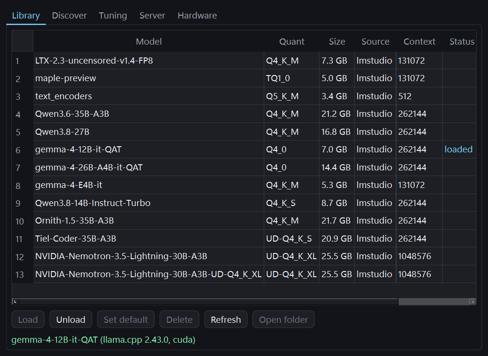
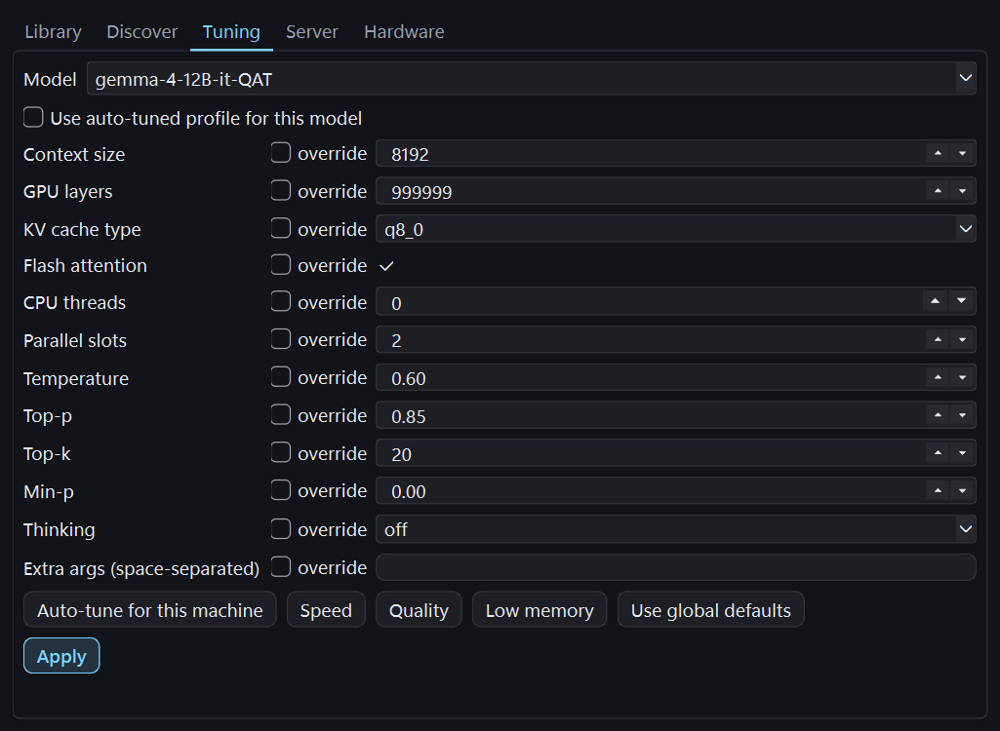
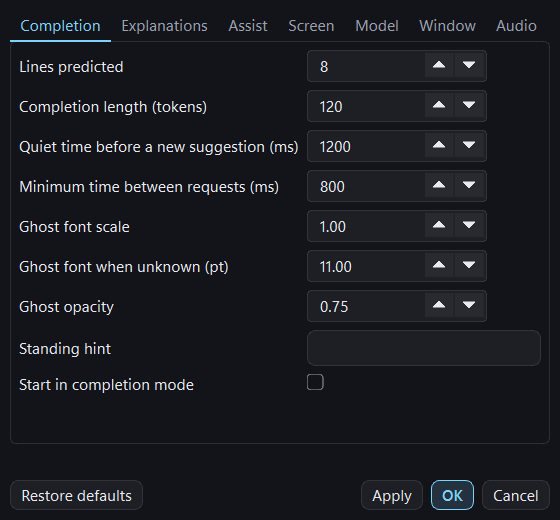
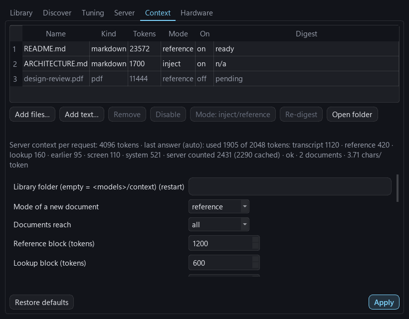

# ExoCortex

A meeting and pair-programming co-pilot that runs **100 % on your laptop**, in an ordinary,
visible window you can share with the team.

It listens to the session (the other participants through WASAPI loopback, you through the mic),
transcribes live with speaker labels, keeps structured notes, keeps a living list of **questions
worth asking** and **blind spots & follow-ups**, recaps the session on demand, notices questions
aimed at you and streams a concise answer into an always-on-top overlay. Tuned for coding
sessions where you drive: see [Pair programming and team coding](docs/PAIR_PROGRAMMING.md).

Nothing leaves the machine unless you switch on Fetch web content or an MCP server over HTTP
(both off by default; see "Capabilities" below). No accounts, no cloud, no telemetry.

| Piece | What runs it |
|---|---|
| Speech-to-text | `[asr].engine = "auto"`: faster-whisper `large-v3-turbo` on the GPU (CUDA, float16, ~0.12 s/utterance) when CUDA is available, else sherpa-onnx (Parakeet-TDT, CPU, int8, ~0.15–0.3 s/utterance — see "GPU support" below) |
| Voice activity | Silero VAD via sherpa-onnx (CPU) |
| Who is speaking | WeSpeaker CAM++ embeddings via sherpa-onnx (CPU, ~10 ms) + online clustering; your mic is always "Me" |
| Answers & notes | `llama-server` (llama.cpp) spawned by the app, hidden, from an LM Studio runtime pack for your GPU when one is installed, else the pinned official llama.cpp build fetched automatically (CUDA 13/12, ROCm, Vulkan, CPU) — or Ollama, or any OpenAI-compatible server (`[llm].backend = "auto"` picks); model files from this app's own library (`models/llm/`) plus LM Studio's, when present. Default model `maple-preview` |
| Overlay | PySide6, frameless, translucent, always on top; an ordinary window (taskbar, Alt+Tab, visible to screen sharing). Its own windows are blanked out of the screen text it reads (`[screen].exclude_own_windows`) |

**LM Studio is optional, used only as a second model/runtime source** if you already have it
(download / inspect / organise GGUFs there and let it keep the llama.cpp runtime for your GPU
updated). It does not need to be running during a meeting, and this app has its own library and
its own runtime fetcher for a machine that has never installed LM Studio at all — see "Models: the
library and the Models window" below.

## Requirements

- Windows 11 (build 19041 or newer for capture exclusion).
- **Nothing else to install first.** As of 2026-09-27, one `run.bat` run sets up a working local
  LLM on its own: the llama.cpp runtime for this GPU, the speech models, and (on an empty library)
  a prompt to pull one model — no LM Studio and no Ollama required. **LM Studio stays optional**
  (its model folder is read as a second library source, and its runtime packs are still preferred
  when installed) and so does **Ollama** (`[llm].backend = "auto"` still finds one already running
  and lets it drive answers instead). See "Install & run" below and "Models: the library and the
  Models window" further down.
- **Python is optional.** `run.bat` uses a system Python (3.11–3.13) if one is installed, or
  downloads a small private one for itself via [uv](https://astral.sh/uv) — nothing system-wide.
- **No NVIDIA GPU required.** NVIDIA (tested: RTX 5080/5090 Laptop, driver 592), AMD (tested:
  Radeon 8060S iGPU, Ryzen AI MAX+ 395) and Intel iGPUs all get a GPU-accelerated LLM backend; see
  "GPU support" below for what runs where. A machine with no usable GPU at all still works, on the
  CPU llama.cpp pack, CPU Whisper/sherpa-onnx and CPU OCR — just slower.
- A headset is recommended: with laptop speakers the mic hears the other side too (an echo filter
  drops duplicates, but a headset is cleaner).

## Install & run

```bat
git clone <this repo> dev-assist
cd dev-assist
run.bat            :: finds/installs Python, creates .venv, installs requirements + this
                    :: machine's GPU extras, starts the overlay
run.bat --doctor   :: same setup, then a full environment report instead of launching
                    :: (GPU, audio devices, models, LLM backend) — run this first on a new machine
```

`run.bat` does everything: it detects the GPU vendor (`exocortex.gpu --vendor`, no driver
required just to ask) and installs the matching extras on top of the vendor-neutral core —
`requirements-nvidia.txt` (CUDA/cuDNN wheels) on NVIDIA, `requirements-directml.txt`
(`onnxruntime-directml`, for OCR) on AMD, nothing extra on Intel/no-GPU machines (OpenVINO in the
core `requirements.txt` covers those). A stamp file (`.venv\exocortex-setup.stamp`) records the
vendor and skips straight to launch on a later run when nothing relevant changed — including the
detected vendor itself, so a driver update or a hybrid-graphics switch is caught.

**First-run setup (2026-09-27).** Right after that pip step, every launch of `run.bat` (and
`run.vbs` through it) also runs `python -m exocortex.setup` (`exocortex/setup.py`) — quick
(~1 s) once everything is already present, so it costs nothing on a machine that is already set
up. Four steps, in order:

1. **The llama.cpp runtime for this GPU** — LM Studio's pack first if one is installed, else the
   pinned official llama.cpp build for the vendor's ladder (CUDA 13.4/12.4, ROCm, Vulkan, CPU;
   downloaded with a progress line). See "Runtime sources" below.
2. **A hardware report** (`exocortex/hardware.py`) saved to `<library>/hardware.json` — GPU/CPU/
   RAM/disk, what runtime pack would be picked, and a recommended model-fit policy; the Models
   window's Hardware tab shows it and the auto-tuned profiles are computed from it.
3. **The speech models** — Silero VAD + the speaker-embedding model, plus the ASR model the
   engine resolves to (the sherpa-onnx Parakeet bundle off CUDA, faster-whisper's checkpoint on
   an NVIDIA box) — so the first meeting doesn't spend its opening minutes downloading.
4. **At least one LLM.** When the model library (see below) holds none yet, the console offers a
   short list recommended for this machine's GPU budget (live sizes fetched from the Hub), a Hub
   search, or "not now". The prompt is skipped — with a hint to use `... > Models...` instead —
   when stdin is not a console, under `--quiet` (what `run.vbs` passes for its hidden catch-up
   runs, `EXO_SETUP_QUIET`) or `EXO_SETUP_NONINTERACTIVE=1`; `--yes` takes the first
   recommendation without asking, for scripted installs.

The step exits non-zero only when no llama.cpp runtime could be found or fetched at all — even
then `run.bat` prints a warning and launches anyway (the overlay transcribes without a model, and
the engine retries the runtime fetch at start). `EXO_SETUP_DRYRUN=1` makes every download/setup
step print what it would do instead of touching the network or disk (what
`tests/test_run_script.py` runs under). See [`docs/INSTALL.md`](docs/INSTALL.md) for the
step-by-step version and `run.bat --setup-only` for scripting it.

For a **completely windowless start** (no console, nothing in the taskbar except the overlay
itself, which is capture-excluded), double-click **`run.vbs`** or make a desktop shortcut to it.
It launches the app under `pythonw.exe` and exits silently. The first run still shows a normal
window for the one-time dependency install; after that it is silent. `run.bat` also launches
windowless now and closes its own console immediately; use `python.exe -m exocortex` directly when
you want a visible console (logs, `--no-ui`, `--doctor`).

**One session at a time.** `run.bat` and `run.vbs` force-close any ExoCortex that is already
running before the new one starts, its llama-server included, and wait until it has exited, so
the old model is off the GPU before the new one loads (two copies of a 27B model do not fit in
24 GB and stall the whole desktop). Only ExoCortex processes and the model servers they started
are closed; llama-swap, LM Studio and everything else are left alone. "Force" means nothing is
saved: the closed session keeps what it last autosaved (every 30 s). The flag behind it is
`--replace`; a plain `python -m exocortex` starts alongside whatever is running.

**Sharing the GPU.** Other model servers on the machine (LM Studio, llama-swap) are left running:
closing them is their owner's call, not this launcher's. But a second large model landing on the
GPU that drives the display makes Windows page GPU memory into system RAM, and the whole desktop
-- not just the answers -- stalls for seconds at a time. A **GPU pressure
guard** samples free VRAM every ~5 s and raises a toast the moment it stays under
`[llm].vram_guard_free_mb` (default 1500 MiB) -- so a mid-meeting slowdown announces its cause
instead of masquerading as a slow model. If the toast names another model, freeing it is one
request to that server -- and the launcher now does it for you: a `run.bat` launch (and a normal
quit) also asks the local llama-swap (`[llm].swap_unload_url`, default `http://127.0.0.1:8081`) to
unload whatever it has resident, so a session starts with the GPU free and leaves it free. Set the
url to `""` to opt out; nothing happens when llama-swap is not running or holds nothing.

Or manually:

```bat
py -3.12 -m venv .venv
.venv\Scripts\python.exe -m pip install -r requirements.txt
.venv\Scripts\python.exe -m exocortex.gpu --extras :: prints the extras file for this GPU, if any:
.venv\Scripts\python.exe -m pip install -r requirements-nvidia.txt      :: NVIDIA (CUDA/cuDNN for Whisper)
.venv\Scripts\python.exe -m pip uninstall -y onnxruntime               :: AMD only: DirectML replaces it ...
.venv\Scripts\python.exe -m pip install -r requirements-directml.txt    :: ... for OCR on the iGPU
.venv\Scripts\python.exe -m exocortex --doctor    :: check GPU, audio devices, models, llama-server
.venv\Scripts\python.exe -m exocortex             :: start the overlay
.venv\Scripts\python.exe -m exocortex --no-ui     :: console mode (transcript + answers on stdout)
```

First start downloads the Whisper model (~1.6 GB) and two small ONNX models (~30 MB) — or, on a
machine where ASR resolves to sherpa-onnx (see below), a ~500 MB Parakeet-TDT bundle instead;
after that everything is offline. Startup takes ~5 s warm (llama-server ~2 s, Whisper ~3 s) on the
NVIDIA laptop this was tuned on; a bigger cold load on another vendor's GPU, or a model library on
slow storage, takes longer — see the table below and `--doctor`.

## GPU support: NVIDIA, AMD, Intel (iGPU and Arc discrete)

Every GPU-facing piece (`exocortex/gpu.py`) routes off the *primary display adapter's vendor*
(DXGI enumeration, no driver required just to ask), with one hard rule this branch was reviewed
against: **the NVIDIA code paths are unchanged, byte-for-byte** — `gpu_vendor() == "nvidia"`
still gets the exact CUDA ladder, `--device` behaviour and thread counts it always did. AMD and
Intel are additions, not a rewrite of the NVIDIA path; Intel Arc discrete GPUs (added
2026-09-26) are a further addition next to the existing Intel iGPU path, not a change to it. See
"Runtime sources" just below for where the `llama-server` binary itself comes from, and
"Limitations & honesty notes" for what is measured here versus designed-and-unit-tested only —
**no Intel Arc GPU exists on either dev box this app has been built or tested on.**

| | NVIDIA | AMD | Intel iGPU | Intel Arc (discrete) | No GPU |
|---|---|---|---|---|---|
| **LLM pack** (`llama-server`) | CUDA 12 > CUDA > Vulkan > CPU | ROCm > Vulkan > CPU (ROCm first where LM Studio installs it -- measured 2026-09-26 on the Radeon 8060S with the 16.8 GB Qwen3.8-27B Q4_K_M, machine idle, ctx 8192, 2 slots: ROCm 2.29.1 processes a fresh 2651-token prompt at ~300 tok/s and answers a cached prompt in 0.4 s, Vulkan 2.46.0 at ~160 tok/s and 3.4 s; generation is equal (11.2 vs 12.4 tok/s); an incremental 953-token append runs at ~273 vs ~92 tok/s. LM Studio only offers the ROCm pack for the `gfx` targets it supports, the 780M is not one, and a ROCm pack that lists no device or dies while loading falls through to Vulkan automatically; `[llm].llama_backend = "vulkan"` pins Vulkan) | Vulkan > CPU | Vulkan > CPU — the same ladder as the iGPU: LM Studio's runtime catalog ships no SYCL/OpenVINO pack for Intel at all, and the llama.cpp community's current recommendation for Arc is Vulkan anyway (as of 2026-07). `[llm].llama_backend = "sycl"` / `"openvino"` opt into the upstream-only frameworks explicitly — see "Runtime sources". **Unverified**: every Arc-specific behaviour in this row is a unit-tested design, not a measurement. | CPU |
| **Whisper / ASR** (`[asr].engine = "auto"`) | faster-whisper `large-v3-turbo`, CUDA float16 | sherpa-onnx Parakeet-TDT, CPU int8 | sherpa-onnx Parakeet-TDT, CPU int8 | sherpa-onnx Parakeet-TDT, CPU int8 (CTranslate2 has no Intel GPU path either) | sherpa-onnx Parakeet-TDT, CPU int8 |
| **OCR accelerator** (`[screen].ocr_device`) | Windows OCR / RapidOCR on CPU only — OCR never touches the NVIDIA GPU | `onnxruntime-directml` on the iGPU/dGPU | OpenVINO on the iGPU or NPU | OpenVINO on the Arc card itself (rule a2: only once no Intel iGPU and no NVIDIA adapter share the machine; otherwise the iGPU keeps the work, or DirectML if there is no iGPU either) | CPU |

**Runtime sources.** The `llama-server.exe` behind the LLM pack row above comes from one of two
places (`[llm].llama_source`): LM Studio's own runtime pack for the chosen framework (`"lmstudio"`)
or a pinned official llama.cpp Windows build fetched straight from `github.com/ggml-org/llama.cpp`
releases (`"upstream"`). **The rule as of 2026-09-27: an LM Studio pack wins first, for every GPU
flavor and every vendor** — a machine that already has an LM Studio pack for the flavor it lands
on is byte-identical to before this mechanism existed, no network call, no ensure() call, ever.
Only once **no LM Studio pack exists for any GPU flavor of that vendor's ladder** does the first
fetchable flavor get the pinned upstream build instead, before finally the CPU pack — this now
applies to every vendor, CUDA and ROCm included, which is the change from before 2026-09-27 (this
branch's earlier rule kept NVIDIA/AMD out of the upstream mechanism entirely; a fresh machine with
neither LM Studio nor Ollama needed a runtime from *somewhere*, so that carve-out is gone). An
upstream-sourced **CUDA** pack may still fall through to the next flavor on a load failure, same as
any other GPU flavor; an **LM Studio** CUDA pack never does (unchanged — NVIDIA's own tuning is
never second-guessed). `"auto"` (default) follows the rule above; `"lmstudio"` / `"upstream"` pin
one source outright.

Most flavors are one zip; **CUDA is two** — the `llama-*` binaries plus a same-release
`cudart-llama-*` zip carrying the matching CUDA runtime DLLs (`cudart64_*`, `cublas64_*`, ...) that
upstream does not statically link — both extracted into the same install folder, recorded in a
`.exocortex-runtime.json` manifest so a multi-zip install can be described and verified later.
NVIDIA gets **two CUDA builds**: `cuda13` (CUDA 13.4, native Blackwell/RTX-50 kernels) once the
driver's leading version is `>= 580`, else `cuda12` (CUDA 12.4, which still runs on Blackwell via
PTX JIT but slower). An upstream build lands at `<repo>/.tools/llama.cpp/<build>/<kind>/` (e.g.
`.tools\llama.cpp\b11200\cuda13`; `[llm].runtime_dir` overrides the root, `""` = the default);
integrity is mandatory, not advisory — every zip is checked against both its exact byte size and
its sha256 before extraction, and only ever installed from a GitHub release asset that itself
publishes a sha256 digest. `[llm].llama_upstream_build` pins the release tag (default `"b11200"`),
so a fresh install never makes a network call just to discover asset digests.

**Live-verified 2026-09-27**, RTX 5080 Laptop dev box (driver 592.82), `LMSTUDIO_HOME` pointed at
an empty folder so no LM Studio pack existed at all: `find_server_binary` under the default
`"auto"` fetched `llama-b11200-bin-win-cuda-13.4-x64.zip` + `cudart-llama-bin-win-cuda-13.4-x64.zip`
(423.5 MB in 24.5 s for the cudart zip) and picked flavor `nvidia-cuda12`, source `upstream`,
framework `cuda`, no fallbacks; `llama-server` was **ready 40.0 s after `start()`**, including both
downloads; `/health` 200; a 24-token completion (Qwen2.5-0.5B Q4_K_M) in 0.22 s — 318 tok/s prompt,
473 tok/s generation.

### Intel Arc verification checklist

No Intel Arc GPU exists on either dev box this app has been built or measured on; everything Arc-
specific above is a unit-tested design (synthetic `GpuInfo` / `--list-devices` data), not a live
result — see "Limitations & honesty notes". Run these once real hardware is available, in order,
and report the tokens/s you get:

1. `python -m exocortex.gpu --json` — the Arc adapter's `driver` field is present and parses as a
   dotted version (`gpu.driver_version`, registry-based).
2. `--doctor`'s GPU section shows the Arc's advisory notes (`gpu.intel_arc_notes`): Vulkan-over-
   SYCL, the Xe2 cooperative-matrix driver threshold on Battlemage, or the Alchemist `GGML_VK_*`
   folklore, as applicable to the card.
3. The default `[llm].llama_source = "auto"` picks LM Studio's Vulkan pack when one is installed,
   or fetches the pinned upstream Vulkan build automatically when LM Studio has no pack for this
   vendor at all (the doctor's llama.cpp section shows `source: upstream` when that happened).
4. `llama-server --list-devices` (or the doctor's device line) shows the Arc adapter by name.
5. `[llm].llama_backend = "sycl"` with `llama_source = "upstream"` resolves and starts (or falls
   through to Vulkan with a `fallbacks` entry naming why, e.g. "lists no GPU device").
6. A SYCL run's environment carries `ZES_ENABLE_SYSMAN=1` unless `[llm].llama_env` already sets it.
7. A GPU pack (any framework but CUDA) that dies while loading gets exactly one same-pack retry
   with `--flash-attn auto` + an f16 KV cache, visible as a `"retrying <flavor> with flash-attn
   auto + f16 KV"` line in the doctor's/log's fallbacks, before falling through to the next flavor.
8. Quitting while the model is still loading returns promptly — within about one poll tick, not
   the rest of the startup timeout.
9. On an Arc-only machine (no Intel iGPU, no NVIDIA adapter), `resolve_ocr_device()` returns
   `("gpu", "GPU.n")` — OpenVINO on the Arc card itself, rule (a2).
10. Report the actual tokens/s (prompt processing and generation) so the numbers in this README
    and `SPEC.md` can move from "designed" to "measured".

Measured numbers, NVIDIA laptop (Core Ultra 9 285H + RTX 5090 Laptop, 2026-09-20) next to this
AMD dev box (Ryzen AI MAX+ 395 / Radeon 8060S iGPU, no NVIDIA driver at all, 2026-09-25/26):

| | NVIDIA (RTX 5090 Laptop) | AMD (Radeon 8060S iGPU) |
|---|---|---|
| LLM load | `maple-preview` (4.6 GB, TQ1_0): 1.3–3 s | `Qwen3.8-27B-Q4_K_M` (16.8 GB): 16–17 s warm on either pack; **361 s cold** from this box's removable exFAT card (~50 MB/s) — storage-bound, not GPU-bound (see "Model storage matters" below); the startup deadline scales with model size and media, so the app waits instead of giving up |
| LLM generation | ~62 tok/s (TQ1_0's ternary tensors run on the CPU; a conventional Q4_K model uses the GPU fully) | `Qwen3.8-27B-Q4_K_M`, machine idle: **ROCm** ~300 tok/s prompt processing, 11.2 tok/s generation, 0.4 s to the first token on a cached prefix; **Vulkan** ~160 tok/s, 12.4 tok/s, 3.4 s (not the same model as the NVIDIA column — no conventional Q4_K model this size exists on both machines to compare head-to-head) |
| Whisper / ASR | faster-whisper, CUDA float16: ~0.12 s/utterance | sherpa-onnx Parakeet-TDT, CPU int8: **0.19 s** median/utterance (8 threads) vs faster-whisper's CPU fallback on the same box, 6.03 s — 0.99 vs 1.00 mean word overlap, why "auto" picks sherpa off CUDA |
| OCR, dense screen | RapidOCR on the Intel Arc 140T iGPU (OpenVINO): 0.73 s | `onnxruntime-directml` on the Radeon 8060S: ~0.95 s wall / ~1 s CPU (OpenVINO's GPU plugin crashes on this hardware — see Limitations) |

A GPU vendor with a GGUF too large for its memory budget, or a llama.cpp flag combination the
build rejects, degrades loudly (a status line / `--doctor` line / log warning), never silently:
`[llm].model = "auto"` picks the largest GGUF that leaves ~25% headroom, a name that doesn't
exist falls back to "auto" with a warning, and `flash_attn = false` together with the default
`kv_cache_type = "q8_0"` is refused by llama-server itself (not a graceful degrade) — the app
forces the V cache to `"f16"` and logs why rather than crash the server (see Limitations).

**Model storage matters more than vendor tuning.** On this AMD dev box the model library sits on
a removable exFAT card in a card reader; a cold load of the 16.8 GB target model took 323 s —
past the 180 s default startup timeout — while a smaller 3.8 GB model on the same volume loaded
in 90.5 s cold but 7-8 s once Windows had it cached. `estimate_startup_timeout_s()` now scales the
wait by the model's volume kind (removable/remote/fixed) so a slow card doesn't get treated as a
crashed server; moving the library to an internal drive is still the real fix.

`[llm].backend = "auto"` also covers **Ollama**: a machine with neither a usable llama.cpp pack
nor a GGUF library falls through to a running (or auto-started) Ollama server, then any
OpenAI-compatible server, before giving up with a message naming what to install for that GPU
vendor. See `exocortex/llm/route.py`.

## Using it

1. Start the overlay before or during the meeting. It parks in the top-right corner and always opens
   on the **Assist** tab. The status bar shows **Hidden from screen capture** when the exclusion is
   active.
2. Share your screen normally. The overlay is not part of what Zoom / Teams / Meet / OBS (Windows
   Graphics Capture) send. It *is* visible to a phone camera pointed at the screen, to `PrintWindow`
   based tools and to some remote-desktop products — see limitations.
3. **Live** tab: rolling transcript. Remote speakers are `Speaker 1`, `Speaker 2`, … — double-click a
   name to rename. Detected questions are highlighted with an **Answer** button.
4. **Assist** tab: when someone asks a question, the answer streams in automatically (toggle with the
   ⚡ button or `Ctrl+Alt+T`). `Ctrl+Alt+A` answers the last thing said on demand; the ask box at the
   bottom (`Ctrl+Alt+Q`) answers anything using the transcript as context. Autonomous answers to
   what is on your screen land here too (see below).
5. **Notes** tab: structured notes (summary, key points, decisions, action items, open questions),
   refreshed every 3 minutes and on `Ctrl+Alt+N`.
6. **Bottom controls** (always visible, under the ask box):
   - **Read** — read the screen right now (capture + OCR) instead of waiting for the next pass.
   - **Revert** — go back to the previous answer (click again to step further back).
   - **Reset** — clear the transcript, answers and notes and start a fresh session.
   - **Pause / Resume** — pause *all* automatic activity at once: screen reading, auto-answer, and
     auto-solve. Nothing is captured or sent while paused; manual actions still work.
   - **Checkpoint** (`Ctrl+Alt+B`) — soft-reset the *coding* context only: solve, **Code** and
     completions start fresh from here (only what is said/solved after this point, and no plan).
     The transcript, notes and answer history keep the whole meeting; a divider marks the cut in
     the Assist tab's history.
   - **Text** (accent-coloured, left of **Code**) — a plain-English walkthrough of whatever has
     been discussed or is on screen since the last checkpoint: what is asked, the key insight, the
     approach step by step, the edge cases and the complexity (for a non-coding question, the
     reasoning that leads to the answer). Picks the latest question or task that matters when
     several are around, and builds on code produced earlier for it, if any. Works even while
     paused, and lands in the Assist tab. Full overlay only — it is not in the slim bar — and has
     no hotkey.
   - **Code** (`Ctrl+Alt+G`, accent-coloured) — write the code for whatever has been discussed or
     is on screen since the last checkpoint, right now. Works even while paused; if the task asks
     for a change to code it just wrote, it builds on that instead of starting over.
7. Everything is saved to `~/Documents/ExoCortex/sessions/<timestamp>/` (transcript.md/.jsonl,
   notes.md, answers.md, session.json, llama-server.log).

### Hands-free mode

The switch at the right of the tab strip — usable from the **Assist** tab, `Ctrl+Alt+H`, or
`Context ▾ › Hands-free` in the slim bar — makes the co-pilot run the whole cycle by itself,
no button presses.

- It samples the screen at `[screen].interval_s` (1.5 s by default, the ordinary capture
  cadence) and compares each new sample only against the one right before it — never against
  however long ago the last cycle ran, so the screen drifting further and further from where a
  cycle last fired never triggers anything by itself. A cycle starts on a **new task**, any one
  of:
  - a fresh line of prose that reads as a question, however short, even under a static header —
    a new question always counts;
  - `min_new_lines` (1 by default) or more fresh lines of prose (3+ words) that are not
    questions but read as something to do — an instruction, a task-like line;
  - most of the view changed at once: `change_threshold` (60 % by default) of the lines differ
    between two consecutive samples *and* at least `min_changed_lines` (3) of them are new or
    gone — a big scroll through the code, a completely different screen.

  A line being typed is never "fresh" — it's the same line, edited, from one sample to the next,
  however far it ends up drifting over time — and neither is OCR noise on a re-read, a counter
  that ticked, or a typo fix. Polls, feedback prompts and the rest of `[assist].ignore_patterns`
  never count either. Which fresh lines are worth starting a cycle over follows `[assist].focus`
  — one setting on the **Assist** tab shared with on-screen questions, see "Focus" under Screen
  reading below — code-biased at `auto` (the default) so a chat or an email drifting into view
  does not distract it.
- Once a new task settles (no further change for `settle_s`, 1 s by default) it is re-read with
  the accurate RapidOCR engine (see "OCR on the iGPU / NPU" below) and the app does what you'd
  do by hand: **Checkpoint → Text → Code**. Text streams first so it can be read while Code is
  written (`code_first` swaps them; `run_text`/`run_code` drop one); Text is skipped by itself
  while explanations are on (Code then opens with its own walkthrough) and in completion mode
  (the slim bar has nowhere to show prose).
- **When code is on screen.** A snippet, an editor's line-number gutter, a development window in
  front (VS Code, PyCharm, a terminal, LeetCode…) or a statement that asks for code all make it a
  *code task*, and `[handsfree].on_code` decides the cycle: `code` (the default) runs **Code
  only** — and its ask also covers a question ABOUT the code shown (its output, a bug, which
  option is right), so a quiz slide with a snippet still gets an answer instead of the model
  shrugging at it; `code_first` runs Code then Text; `ignore` keeps the usual Text → Code order.
- **Cumulative screen context.** Every accurately read screen is folded into a running document
  for the current task, so text that has scrolled out of view — the problem statement, code
  typed further up the file — stays available to Text/Code (`context_chars`, 6000 chars by
  default, bigger than the ordinary screen context on purpose).
- **Deviation-driven regeneration.** When the code on screen has drifted from what the app
  itself last wrote (`deviation_threshold`, 50 % by default), Code is regenerated — no
  checkpoint — so the solution builds on what you actually typed instead of what it last
  suggested.
- A new task mid-cycle checkpoints again and starts over: there is no minimum time between
  cycles, the screen alone decides. A step a spoken question preempted is retried (up to twice)
  instead of leaving a blank answer; a step the model itself genuinely found nothing to do for
  is simply marked done, not retried.
- Automatic solving and answering a new on-screen question are suppressed (the hands-free cycle
  replaces them); a spoken question is still answered, explanations still run, and completion
  mode still works. **Pause** pauses the watcher too; **Reset** forgets the current task; a
  checkpoint you set yourself while hands-free is on means "redo this screen".

**Click-through output view.** While hands-free is on, the overlay collapses to an output-only
pane: the tabs, ask box, control row and status bar disappear and only the answer text (plus the
history list, if you had it expanded) is shown. Only the title bar and the switch stay
clickable; everywhere else the mouse passes straight through to whatever is underneath, tracked
live as the cursor moves so you never have to toggle click-through by hand — the ◈ click-through
button is hidden for the duration, since the view is managing it itself. Hovering the answer or
the expanded history still scrolls it: the mouse wheel reaches the pane under the cursor even
though the window is click-through there (a low-level hook sees the wheel first and swallows the
notch before it reaches whatever is underneath; where that hook can't be installed, the pane
becomes clickable instead while hovered, so the ordinary wheel still reaches it). Hovering the
expanded history, an **Up** / **Down** tap snaps to the previous / next answer and marks it with
a left accent bar, so you can step through what it produced without touching the scrollbar. Turn
the switch off (or `Ctrl+Alt+H`) to get the full overlay back.

**Pause / resume without a click.** `[hotkeys].toggle_pause` (a tap of the right Shift key by
default) pauses/resumes everything automatic — the hands-free watcher included — even though the
Pause button itself is hidden in this view. A *tap*, not a hold: pressed and released with no
other key in between, so Shift held down for a capital letter while you type never trips it, and
typing keeps working. `rctrl`, `ralt`, a plain key such as `right` (the arrow), or a
`ctrl+alt+p`-style combination all work too; `""` turns it off. A toast confirms **Paused** /
**Resumed**.

### Manual advance

The **Manual** switch next to the Hands-free switch (`Ctrl+Alt+J`, `Context ▾ › Manual advance`
in the slim bar, `[handsfree].manual`) trades the automatic generation above for an on-demand
gesture. Off — **Auto** — everything works as described elsewhere in this README. On, nothing
starts a model call by itself, so the GPU sits idle and no context is spent until you ask:

- **What keeps running:** the transcript (ASR), screen scans (OCR), hands-free's watching,
  settling and task detection, its auto-checkpoint on each new task, the cumulative screen
  context, and question detection. Only the *generation* waits: hands-free Text/Code, spoken-
  question auto-answers, on-screen question answers, automatic solves/suggestions, automatic
  notes and automatic explanations. (Completion mode is its own deliberate mode and is not
  gated; every manual action — Answer, Ask, Notes, Text, Code, Suggest, Explain — works as
  always.)
- **The gesture**, anywhere on screen, in whatever app has focus: **press and hold the left
  mouse button** for `manual_hold_s` (0.8 s by default, on the Hands-free settings tab) to
  generate **Text**; **click the middle button** (press the scroll wheel) for **Code** — no
  hold needed there by default. Whether each action requires the press-and-hold is its own
  checkbox on the Hands-free settings tab (`manual_hold_text`, on — unchecking it makes *every*
  left click generate, so leave it unless you mean that; `manual_hold_code`, off). Moving the
  pointer while a button is down — a drag, a text selection, an autoscroll — always cancels,
  as does pressing another button or rolling the wheel, so clicking-and-dragging never triggers
  anything. The click still reaches the app underneath (nothing is swallowed), and the overlay
  never comes to the foreground or takes focus — it keeps its translucent, click-through state
  and the output just streams into the Assist view as usual.
- **Touchpads:** a three-finger tap triggers Code once Windows maps it to a middle click
  (Settings › Bluetooth & devices › Touchpad › Three-finger gestures › Taps → "Middle mouse
  button") — a tap can't be held, which is exactly why Code doesn't require the hold by
  default. (Windows delivers that tap as *injected* input, and the hook deliberately accepts
  injected clicks for the same reason.)
- **With hands-free on** the two combine: the watcher still reads and checkpoints each new task
  and the title bar shows `hands-free · armed · hold left = Text, middle = Code` — the task is
  ready, nothing has been spent. The gesture then runs that step for the task on screen (a code
  task keeps the code-task ask, so a quiz slide with a snippet still gets a real answer), and
  deviation-driven regeneration is off — hold the middle button when you want the code redone
  around what you typed. The gesture works over the overlay's own translucent, click-through
  area too (that's the app underneath as far as clicks go); only the title bar, the switches,
  and the app's dialogs don't count. Flip the switch back to **Auto** and a task still sitting
  armed runs by itself, the way Auto would have run it. With hands-free off, the gesture is
  simply the Text / Code button without touching the overlay.

### Dashboard mode

The **▦** button at the left of the title-bar icons (`Ctrl+Alt+D`, `⋯ › Dashboard mode`,
`[dashboard].enabled`) turns the overlay into a board: **Session notes**, **Action items**,
**Goals**, **Constraints**, **Questions to ask** and **Blind spots & follow-ups**, side by side,
each column kept current by itself and each one hideable (**⋯ › View**). The action items are a
tree: the primary tasks the brief or the discussion asked for, their sub-tasks indented under
them, and under the item they serve the prompts to type into Claude Code next, exactly as you
would type them (copy one with **⧉**); the goals are the acceptance criteria, grouped by the
task each is for; the constraints are the rules and guardrails in force. Everything is
*tracked*: once the conversation answers a question or finishes a step, it moves under
**Answered (n)** / **Done (n)** with the answer, a goal is marked **met** with the evidence, a
constraint is lifted when it no longer applies. While the board is on, the running notes keep
the narrative only (summary, key points, decisions, open questions). The window widens to
`[dashboard].width` and shrinks back when you leave the mode; the ask box and the bottom
controls stay, so asking, pausing, **Text** and **Code** keep working.

The data is not the model's memory. A small database in the session folder (`dashboard.sqlite`,
also written as `dashboard.md`) holds the items, and each refresh hands the model only the open
items (under short ids, the sub-tasks indented under their task) plus what was said since the
last refresh, asking for the changes alone (`NEW: …` / `NEW under N1: …` / `ANSWERED Q2: …` /
`DONE N2: …` / `MET G1: …` / `DROP B1`). A background refresh runs at most every
`[dashboard].refresh_interval_s` (90 s) once `min_new_words` (40) arrived or the code on screen
changed substantially; it replaces the Notes tab's insights passes while `[dashboard].track` is
on, and the Insights pane then mirrors the board's open items. Screen capture and OCR keep their
own cadence (`[screen].interval_s`) in every view mode.

If a Claude Code toolkit is installed in the repository you are working in, dev-assist discovers
it by itself — the skills, agents, rules, workflows and hooks under `.claude/`, the house rules'
working loop and the detected commands in `CLAUDE.local.md`, re-checked every `rescan_s`
seconds, nothing hard-coded — and every suggested prompt opens with one of its real `/skills` or
agents, named exactly as installed, with the task's details and constraints as arguments (a
prompt naming something not installed is thrown away); answers get the catalog too with
`toolkit_in_answers` on, and a mentioned part's full text is handed over on demand. Which
repository: the one Claude Code last ran in, read from its own session logs
(`[project].repo_auto`, the default), or a folder you pin under **⋯ › View › Repository** /
`[project].repo_root`. The repository itself is never injected wholesale: with `repo_search` on,
the identifiers and file names a prompt mentions are looked up and only the matching lines go in.
Both live on the Settings dialog's **Project** tab, everything else on its **Dashboard** tab.
The card actions, the View menu and every key: [docs/DASHBOARD.md](docs/DASHBOARD.md).

### Screen reading

The **Screen** tab reads what is on your screen and folds it into everything else:

- **Auto** (default) reads the active window every `[screen].interval_s` (1.5 s by default; only
  when it visibly changed); **Monitor** reads the whole primary monitor; **Region…**
  (`Ctrl+Alt+R`) lets you drag a rectangle, e.g. the shared-slides pane or a chat box.
  `Ctrl+Alt+V` pauses/resumes reading.
- OCR runs locally: Windows' built-in OCR (~110 ms per screen) by default, RapidOCR (more accurate,
  slower on the CPU, fast on the iGPU/NPU — see "OCR on the iGPU / NPU" below) with
  `ocr_engine = "rapidocr"`. Nothing is uploaded and no screenshots are written to disk.
- The raw OCR readout is **hidden by default** (it is rarely worth looking at); expand *Screen text*
  in the Screen tab to see it, or set `[screen].show_text = true`.
- The extracted text is added to every answer as context, so "what do you think of this slide?"
  works. When a **new question appears on screen** (a chat message, an interview prompt) it is
  answered automatically, like a spoken one.

#### OCR on the iGPU / NPU

RapidOCR's detection + recognition models can run through OpenVINO on the Intel integrated GPU
or NPU instead of onnxruntime on the CPU — `[screen].ocr_device`: `auto` (default: iGPU, then
NPU, then CPU), `igpu`, `npu`, `cpu`. Windows OCR (the default sampling engine) is always CPU and
unaffected; this only concerns RapidOCR, which hands-free mode uses for its accurate re-read
(`[handsfree].accurate_ocr`) and which `ocr_engine = "rapidocr"` uses for sampling too.

Measured on this laptop (Intel Core Ultra 9 285H, Arc 140T iGPU, AI Boost NPU, RTX 5090 Laptop;
a dense 2560×1600 page, 97 lines, OCR input downscaled to 2200×1375):

| Engine / device | Wall time | CPU time |
|---|---|---|
| Windows OCR (CPU) | 108 ms | 109 ms |
| RapidOCR, onnxruntime CPU | 3.7 s | 37 s (all cores) |
| RapidOCR, OpenVINO CPU | 1.9 s | 9.9 s |
| RapidOCR, OpenVINO iGPU (Arc 140T) | **0.73 s** | **0.74 s** |
| RapidOCR, OpenVINO NPU (AI Boost) | 1.45 s | 0.6 s |

- Both accelerators pay per distinct input shape, so inputs are padded to a small set of shape
  buckets (det: the screen size rounded up to a 256 px grid; rec: batch of 6, width bucketed
  320…4096). Without that, the iGPU JIT-compiled kernels for every new text-crop width it met and
  one fresh screen took 37 s. Compiled kernels are cached under `<models_dir>/ov_cache` (~190 MB),
  so the cost is paid once per machine: the common buckets are warmed at start-up on a background
  thread (the cheap Windows OCR sampling starts at once; the first accurate read simply waits) —
  **iGPU** ~25 s the first time ever, ~7 s with the cache; **NPU** 8–14 s per bucket the first
  time, ~0.2 s from the cache. A bucket met later compiles on first use (~2–3 s iGPU) and is
  cached from then on. The iGPU keeps the dynamic-shape model (a reshaped static model came back
  wrong from OpenVINO's cache on the GPU — 1 line instead of 95 — while the NPU's static blobs
  cache correctly). A dense real desktop (220 lines) reads in ~1.5 s on the iGPU.
- **Process-order rule.** Creating a RapidOCR engine (onnxruntime or OpenVINO, any device) after
  a Windows OCR engine exists in the same process crashes the interpreter outright (access
  violation); RapidOCR first, Windows OCR second, coexist for the life of the process. The screen
  reader always builds the accurate RapidOCR engine before the Windows OCR sampling engine for
  this reason, and RapidOCR refuses to be created (rather than crash) if a Windows OCR engine
  already exists in the process.
- **Honest note.** OCR never runs on the RTX 5090 — `ocr_device` never picks a discrete GPU, so
  the card stays free for Whisper and llama-server. The iGPU/NPU win here is CPU time and
  latency, not GPU headroom borrowed from anything else.

**Focus.** `[assist].focus` — one setting on the **Assist** tab — decides what is worth a model
call, for on-screen questions here and for what starts a hands-free cycle (see "Hands-free mode"
above) alike, least to most permissive: `technical` answers only text with technical substance
(theory, concepts, design, math, code); `auto` (default, code-biased) answers a question or
anything that reads as a task, drops personal-opinion questions ("do you like…", "have you
ever…") unless they carry a technical cue, and otherwise reads broadly — catching plenty beyond
code without chasing every aside; `all` reads everything and tries to answer as much as possible.
Site polls and surveys (LeetCode's "Have you seen this in an interview before?"), feedback /
rating prompts, sign-up and cookie banners and the rest of `[assist].ignore_patterns` (extra
regexes) are dropped at every level. An on-screen question never cancels an answer or a solve
already streaming (it waits its turn), and a job that genuinely finds nothing to answer is simply
marked done rather than left blank.

**Autonomous mode** (`[assist].autonomous = true`, the default) makes it hands-off: when the screen
changes it does not just suggest talking points, it **solves whatever is shown** — a LeetCode /
coding problem (full solution in a fenced code block plus its complexity), an interview or exam
question (the answer), a form or half-typed message (the exact text to enter) — and streams the
finished result into the **Assist** tab. It works it out itself and does not stop to ask how you
want to proceed. The one time it asks: when the task genuinely forks (say two plausible languages),
it shows a couple of **click-to-choose buttons** under the answer, so you pick a direction with one
click and never type. Turn it off to get the old talking-points behaviour, where **Suggest now**
(`Ctrl+Alt+S`) and auto-suggest produce up to three points plus a `Complete: …` line.

**Multiple-choice questions.** When the screen (or a question you type) shows answer options —
`A. / B.`, `1. / 2.`, radio buttons or checkboxes, True / False — the co-pilot works out which
option is most likely right and always ends the answer with a bold **Answer: C — 7** line (just
the option text when the options carry no labels, several labels when more than one applies), so
the verdict never has to be hunted for inside the explanation. Enumerated options reach the model
as `Choice 1: 4`, so `1. 4` can no longer be misread as the decimal 1.4. A numbered or bulleted list
only counts as an option set when a question sits next to it; agendas, slide bullets, instruction
steps and site polls are left alone, and a spoken or typed question only borrows the options on
screen when it refers to them ("which one is it?").

### Completion mode (inline ghost text where you type)

The **⌨** toggle left of the ⚡ bolt (or `Ctrl+Alt+K`) collapses the overlay into a one-row
**slim bar** — `Full` · `Context ▾` · `Explain ▾` (only shown with explanations on) · `Reset` ·
`Pause/Resume` · `Checkpoint` · `Code` (accent-coloured) · status · hide · `⋯` — and turns on
inline completions: wherever you are typing (a chat box, an editor, a form, a code file), a
grey **ghost-text** continuation appears at your caret, in the same font size, so you can simply
type over it. `Ctrl+Alt+Space` hides the bar completely; completions keep working until you
`Pause`. `Checkpoint` and `Code` do exactly what they do in the full overlay (see "Using it"
above) and are also reachable from the `Context ▾` menu ("Checkpoint (new coding task)" /
"Code now") so they cost no extra width when the bar is tight. **Text** is a full-overlay control
only — a walkthrough is meant to be read in the Assist tab, which the slim bar hides — so it is
not part of the bar at all.

- It reads what you have typed through Windows accessibility (UI Automation / MSAA — what screen
  readers use), never a keyboard hook. Password fields and ExoCortex's own windows are always
  skipped. Works with Chromium apps (VS Code, Chrome, Edge, Teams, Slack, Discord…), Notepad,
  Office, classic Win32 edits.
- **Code editors that hide their text** (Monaco: LeetCode, VS Code, CodeSandbox and most web IDEs
  expose nothing to accessibility unless their screen-reader mode is on) are handled from the
  screen instead: the code above and around your caret is rebuilt from the screen reader's OCR
  (same pane only, gutter line numbers stripped, indentation restored from the pixel positions),
  the caret position still comes from accessibility, and typing is followed through the caret's
  movement with an OCR re-sync about once a second. For the best result on LeetCode, press
  `Ctrl+Alt+R` once and drag the screen region over the **editor pane** so OCR reads only your
  code; or turn on the editor's screen-reader mode (`Alt+F1` inside the editor) to give it the
  exact text.
- Suggestions come from the **whole session since the last Reset**: transcript, previous answers,
  notes and the current screen text. `Context ▾` chooses which of those feed it and lets you set a
  standing **hint** ("Python 3, terse", "reply in French").
- **Type over it.** Typing what the ghost text says just shrinks it and follows your caret — no new
  model call. Spacing/indentation differences are tolerated. Backspacing into what you typed grows
  it back. Typing something else makes it disappear; a new suggestion is only requested after you
  stop typing for `debounce_ms` (1.2 s by default), so typos and half-typed indentation never
  trigger churn.
- Automatic answers and auto-solve are suppressed while completion mode is on (they would compete
  for the model); notes and the transcript keep recording as context.
- It predicts **several lines at once** (`max_lines`, default 8; with explanations on that is the
  next 8 lines of the plan). Everything is under `[completion]` in `config.toml`: `poll_ms`,
  `debounce_ms`, `max_tokens` (120), `max_lines`, the context sources, `hint`, `ghost_color`,
  `font_scale` — or use **Settings…** (below). Set `enabled = true` to start in completion mode.
  `--doctor` reports whether caret tracking works.

Ghost text is sized from the editor's reported font (falling back to the caret height, then
`[completion].default_font_pt`); a hidden 1-px input's caret is never used as a line height.
`docs/screenshots/overlay_slim.png` shows the bar; `ghost_prose.png` and `ghost_code.png` are real captures of
the ghost text in Notepad (prose, and an indented two-line code continuation).

Measured on this laptop: first suggestion 1.5–2 s after you pause (the session context is
evaluated once), then 0.2 s for follow-ups thanks to llama.cpp's prefix cache; the caret probe
costs 4–15 ms every 150 ms.

### Explanations (walkthrough → commented code → explanation)

The **💡** toggle (left of ⌨, or `Ctrl+Alt+E`, or `Context ▾ › Explanations` in the slim bar)
turns every solution into a three-act **plan**:

1. **Walkthrough first.** Before any code, the model writes a short block on what the problem
   asks, the key insight, the approach and the edge cases — its thought process — and it streams
   into the Assist tab (or the slim bar's drop-down) *before* the solution does.
2. **Commented code.** The solution code is commented according to `[assist].comments` — see
   "Comments in generated code" below.
3. **Explanation after you have typed it.** Once the solution's code is on screen — the screen
   reader sees ≥ 90 % of its lines (`[explain].typed_fraction`), or in completion mode you typed
   the last line — an explanation of the finished solution follows: what each part does, why it
   is correct, the complexity, and one likely follow-up question. `Explain ▾ › Explain now`
   asks for it earlier; `Rethink` solves the task again.

In **completion mode** the plan is what the ghost text follows: each line you type is aligned
against the solution and the next lines appear instantly, straight from the plan — no model call
per line. **Comments are optional to type**: if you type past a comment straight into the code
that follows, the comment simply disappears and the rest of the code stays; nothing is
regenerated. Type something that is not in the plan and the usual model completions take over
(with the plan as context) until you are back on it. The slim bar gains an **`Explain ▾`**
drop-down whose panel shows the **Walkthrough** and the **Explanation** (it opens by itself when
they arrive; `×` closes it), and its status reads `thinking…` → `solution ready — type it out` →
`explaining…` → `explanation ready`. While explanations are on, a screen change still triggers
the solve in completion mode (it is the source of the ghost text), but typing the solution into
the editor never counts as a new task — only a genuinely different screen does.

Explanations cost a longer solve (`[explain].walkthrough_max_tokens` more, ~4 s here) and one
extra model call per solved task (`explain_max_tokens`). For the best plan on LeetCode keep the
problem statement in view (screen mode *auto* or *monitor*): with the OCR region restricted to
the editor pane the model only sees your code.

### Comments in generated code

`[assist].comments` controls how densely solve, the **Code** button, and code continued by
completions are commented. Four levels:

- **`none`** — no comments at all.
- **`minimal`** — 2-3 comment lines, only before the genuinely important steps.
- **`normal`** (default) — a short comment above every logical step, plus a one-line summary at
  the top; richer than `minimal`, short of a line-by-line narration.
- **`detailed`** — the fenced code block opens with a comment block stating the requirements
  (inputs, outputs, constraints, edge cases) and then the pseudo-code of the approach, step by
  step, before a blank line and the real code — the way an engineer talks a coding challenge
  through in the editor before typing the solution — and the code itself then carries a comment
  above most of its lines.

Whatever the level, every comment is a whole line of its own, right above the code it describes,
never trailing at the end of a line — so completion mode can still let you type past a comment
without disturbing the ghost text underneath it. The old, fixed behaviour (one short comment
before each non-obvious step, none elsewhere) is what `minimal` reproduces. `normal` and
`detailed` need more room to generate: `[llm].solve_max_tokens` gets +100 tokens of headroom at
`normal` and +350 at `detailed` (`none`/`minimal` add nothing).

This setting replaces the old `[explain].comments` boolean; an existing `config.toml` that still
has `comments` under `[explain]` just logs one ignored-key warning at startup and otherwise keeps
working (`[assist].comments` defaults to `"normal"`).

### Hotkeys (global, work while the meeting app has focus)

Every shortcut, including the in-window keys, the mouse gestures and how to get a hidden overlay
back, is listed in [docs/SHORTCUTS.md](docs/SHORTCUTS.md).

| Keys | Action |
|---|---|
| `Ctrl+Alt+Space` | show / hide the overlay |
| `Ctrl+Alt+A` | answer the last thing the other side said |
| `Ctrl+Alt+Q` | focus the ask box |
| `Ctrl+Alt+N` | regenerate notes |
| `Ctrl+Alt+T` | toggle auto-answer |
| `Ctrl+Alt+M` | mute / unmute your mic transcription |
| `Ctrl+Alt+C` | click-through mode (mouse passes through the overlay) |
| `Ctrl+Alt+←↑→↓` | nudge the overlay |
| `Ctrl+Alt+R` | select a screen region to read |
| `Ctrl+Alt+S` | suggestions from screen + conversation now |
| `Ctrl+Alt+V` | pause / resume screen reading |
| `Ctrl+Alt+K` | completion mode on / off (slim bar + ghost-text completions) |
| `Ctrl+Alt+E` | explanations on / off (walkthrough before, commented code, explanation after) |
| `Ctrl+Alt+B` | checkpoint: the coding context (solve / Code / completions) starts fresh |
| `Ctrl+Alt+G` | Code: write the code for the task discussed / shown, right now |
| `Ctrl+Alt+H` | hands-free mode on / off (auto read → checkpoint → text → code on screen change) |
| `Ctrl+Alt+J` | manual advance on / off (generate only on a press-and-hold: left = Text, middle = Code) |
| `Ctrl+Alt+D` | dashboard mode on / off (the ▦ button: notes, action items with sub-tasks and prompts, goals, constraints, questions, blind spots as a board) |
| *(tap)* Right Shift | pause / resume everything automatic (screen reading, auto-answer, auto-solve, hands-free) |
| `Ctrl+Alt+X` | quit (saves the session) |

All bindings live in `[hotkeys]` of `config.toml`. `toggle_pause` (`rshift` by default) is the
odd one out: a **tap** of a single key — pressed and released with no other key in between —
rather than a `Ctrl+Alt+…` combination, so it keeps working while your hands are on the keyboard
(Shift held for a capital letter is never a tap). `rctrl`, `ralt`, a plain key such as `right`
(the arrow), or a `ctrl+alt+p`-style combination also work; `""` turns it off.

### Models: the library and the Models window

**`⋯ › Models…`** (or `Context ▾ › Models…` in the slim bar) opens a tabbed model manager —
**Library**, **Discover**, **Tuning**, **Server**, **Context**, **Capabilities**, **Hardware** — that replaces LM Studio's own UI
for everything this app needs: what model is loaded, what else is on disk, and how each one is
tuned. Opened automatically, on **Discover**, the first time the library holds nothing at all
(the app publishes an "empty-library" event and the overlay reacts to it).




(Rendered 2026-09-27 against this laptop's LM Studio folder; the other tabs are
`docs/screenshots/models_discover.png`, `models_server.png` and `models_hardware.png`.)

- **Where files live.** `<repo>/models/llm/<publisher>/<repo>/*.gguf` (`[llm].library_dir`, empty =
  the default) is this app's own library — the same two-level `publisher/repo` layout LM Studio
  uses, so a file dropped in by hand or moved between the two just works. LM Studio's own folder,
  when present, is read too, as a second source; the two are merged into one list (shards grouped,
  a `mmproj` vision projector attached to its base model rather than listed on its own).
- **Library tab.** Every model from both sources, with **Load**, **Unload**, **Set default**,
  **Delete** and **Open folder**. Delete only ever touches this app's own library — a model from
  LM Studio's folder can be loaded and set default here, but never deleted from here (this app
  never deletes another program's files); the button raises a clear error instead of doing
  nothing silently. Unload stops the running `llama-server` (or tells Ollama `keep_alive: 0`);
  every answer is refused with a notice until something is loaded again.
- **Discover tab.** Search the Hugging Face Hub by name; picking a result shows its architecture,
  parameter count and trained context length (read from the GGUF header, never by loading tensor
  data) and a **quant** drop-down with `auto (Q4_K_M, 5.3 GB — fits this machine)` first, every
  other quant the repo offers below it, and an optional "include vision projector (mmproj)"
  checkbox for repos that have one. **Pull the whole model** means every shard of that one quant —
  never a pick-a-file browse of a repo that often holds a dozen quants and a dozen shards each —
  streamed to a `.part` file with an HTTP Range resume (an interrupted pull picks up where it left
  off, not from zero), each file's exact byte size and sha256 checked against the Hub's own LFS
  metadata before the `.part` is renamed into place, and a free-space check before the download
  starts at all. **Cancel** keeps the `.part` for the next resume rather than deleting it. A gated
  repo is pulled the same way once `HF_TOKEN` is set in the environment. **Load now** appears once
  a pull finishes.
- **Quant policy** (`[llm].model` pulls, and the setup prompt's recommendations) — review round two,
  2026-09-27: corrected to match `exocortex.llm.library.choose_quant` / SPEC.md, which exclude the
  float formats from every policy —
  `exocortex.llm.library.choose_quant`: `auto` (default) picks `Q4_K_M` first, then works down the
  K/IQ quant ladder for whichever one fits 75% of the GPU budget (headroom for the KV cache and
  activations); `quality` picks the largest of `Q8_0`, `Q6_K`, … that still fits; `fit` picks the
  largest *non-float* quant that fits (BF16 / F16 / F32 are excluded from every policy, not just
  `auto`/`quality`); a named quant (`"Q5_K_M"`) pins that one exactly.
- **Tuning tab.** Per-model overrides of the global `[llm]` values — context size, GPU layers, KV
  cache type, flash attention, threads, parallel slots, sampling — each behind its own override
  checkbox, so a model keeps following the global defaults for everything you have not touched.
  **Auto-tune for this machine** regenerates the suggestion; **Speed** / **Quality** / **Low
  memory** apply a preset in one click; **Use global defaults** clears every override. Auto-tune's
  formula (`auto_profile`): the largest context that is a multiple of 2048 in
  `[4096, min(the model's trained context, 32768)]` whose weights plus that much KV cache plus a
  768 MiB activation margin fit 75% of the GPU budget; when even a 4096-token context does not fit,
  partial GPU offload instead (as many layers as fit the same margin at a 4096-token context); a
  GPU runtime gets `q8_0` KV cache + flash attention, a CPU-only one gets `f16`.
- **Server tab.** The global `[llm]` settings that used to be the Settings dialog's "Model" tab:
  backend, server URL, the llama.cpp backend/source/device/upstream build, `library_dir`,
  `runtime_dir`, port, load mode, thinking, sampling, token budgets, context size, threads,
  parallel slots, KV cache type, flash attention, request timeout, the VRAM guard. The Settings
  dialog no longer has a Model tab, and the old "Choose model" submenu is gone — this window is
  now the one place both live.
- **Hardware tab.** The same report `exocortex/hardware.py` writes to `<library>/hardware.json` at
  every launch — GPU/CPU/RAM/disk, what runtime pack would be picked right now, library free
  space, the recommended model-fit policy — with a **Refresh** button.

**Still unverified** (see "Limitations & honesty notes"): the window itself has not been driven
live yet (offscreen tests only), and AMD ROCm / Intel upstream fetches through this window are a
unit-tested design, not a measurement.

### Settings

**`⋯ › Settings…`** (or `Context ▾ › Settings…` in the slim bar) opens a tabbed settings page —
Completion (lines predicted, completion length, quiet time, ghost font/opacity, hint),
Explanations, **Hands-free** (what makes a new task — new-line and view-change thresholds, and
**when code is on screen** — settle time, deviation, cumulative context size, Text/Code on or
off, accurate OCR, **manual advance** with its press-and-hold time and the quick-middle-click
option), Assist (including **Focus**, **Use libraries** and **Comments in generated
code**), Notes, **Dashboard** (the board's tracking, columns and width), **Project** (the
repository root, the on-demand repository lookups and the Claude Code toolkit catalog), Screen
(including **OCR device**), Monitor, Window, **Audio** (pick the system-audio and microphone
devices from a list, **Test** each one, and check the speaker routing — see "Audio devices" below)
and **Optimize** (where each job runs on this machine, a benchmark, a plan per goal — see
"Optimize" below) — covering everything in the Configuration section below. The old **Model** tab
(backend, model, context size, llama.cpp
knobs) has moved to **`⋯ › Models…`** (see above) — this dialog no longer touches `[llm]` at all.
**Apply**/**OK** write the values into the running app (most take effect at once;
the few that need a restart, such as the OCR engine or capture exclusion, are marked *(restart)*
and listed after you apply) and save `config.toml` immediately. **Restore defaults** fills in the
built-in defaults without touching anything until you apply.

**Audio devices.** The Audio tab lists what WASAPI actually offers — the loopback devices for
system audio (the other side of the call) and the input devices for your microphone — and says
which device *Default* resolves to. Pick one from the list (stored by its full name, so it survives
a device index renumbering) or type part of a name or a device index. **Test** opens the device for
1.5 s exactly the way the app does (resolve, open at its native rate, downmix, resample), moves a
level meter while it listens and then says in words what happened: *OK … peak −12 dBFS*; *audio flows
but it is silent* (nothing playing, or the mic level is down); *no audio arrived* (WASAPI loopback
idles while nothing plays, or another app holds the device in exclusive mode); or the open error.
The test reads the values as they are on the page, so a device can be checked before it is applied.
The status line shows how many devices were found and what the running app has open right now.
Devices, the keep-alive tone and the two capture switches **apply live** — the affected capture is
reopened in the background, the other source keeps running — while the voice-detection knobs
(speech threshold, silence that ends an utterance, shortest speech kept, longest utterance,
pre-roll) take effect at the next launch. `--doctor` prints the same device list for a shell.

**Check** (under the devices): speakers are attributed by source — the mic is *Me*, the system
audio is everyone else — so the routing decides how right the transcript is. After a microphone
**Test**, a mic Windows has muted (it opens fine but delivers digital silence) or turned down to
0 % is named, with an **Unmute in Windows** button. **Check speaker routing** plays a short chirp
on the output behind the chosen loopback and measures where it lands: it should reach the
system-audio feed and not the mic (a mic that hears the speakers transcribes remote voices as
*Me*), and the verdict offers to turn echo suppression on or off to match. A running mic that has
delivered digital silence for 8 s raises a warning once, and `--doctor` reports a muted mic.

Menus, the settings page and the Models window open **above** the overlay (it is always-on-top,
so without this they would land behind it) and are excluded from screen capture like everything
else. While a menu or a drop-down is open the overlay leaves the window stacking alone, so the
list stays up until you pick something or click away.



### Context: reference documents and the context window

**`⋯ › Models… › Context`** (also `⋯ › Context documents…`, or `Context ▾ › Context documents…` in
the slim bar) is where you hand the model background material and where you watch, and tune, how
every prompt is filled. Added 2026-10-06 for presentation Q&A: load the README, the design and
architecture docs for the thing you are presenting, and the answers to the audience's questions
draw on them.



- **Documents.** **Add files…** (`.md`, `.txt`, `.rst`, code, `.html`, `.docx`, `.pptx`, `.pdf`;
  the text is extracted on the way in and a copy is kept under `models/context/`, so the original
  can move) or **Add text…** (paste). Each document has an **On** switch and a **Mode**:
  - **inject** puts the document's text into every prompt, in a stable `<reference>` block at the
    very start of the user turn, so llama.cpp's prefix cache keeps it evaluated once. Best for a
    short README or a one-page architecture summary that every answer should know.
  - **reference** (the default) keeps the document *out* of the prompt. It is pre-processed once,
    on the notes lane (never delaying an answer): the model writes a 2-4 line **digest** of what the
    document is and covers, and the app indexes the document's passages locally (BM25, no model
    call). Every prompt then carries only the digest in a one-line catalogue ("Reference documents
    available: …"), and the passages that actually match the question at hand (and, with a lower
    weight, the most recent speech) are pulled into a `<lookup>` block for that one answer, only
    when they match. Best for long design docs, where only the relevant section should ever
    cost prompt tokens.
  **Re-digest** regenerates a digest; **Remove** deletes the copy. Documents persist across
  sessions (a new session never touches them) and can be switched on, off or between modes at any
  moment; the next answer sees the change.
- **How the documents are weighted.** The model is told, in every system prompt, that the
  `<transcript>` is what actually happened and that its *last* lines, the most recent speech,
  matter most; that an `<earlier>` block is a summary of this same meeting's earlier part; and that
  `<reference>` and `<lookup>` are background material for reference only: to be used for facts,
  names, numbers and details when the conversation calls for them, never to override or redirect
  what was just said, never to be answered about unprompted. The prompt's own order says the same
  thing: documents first (stable, far from the question), transcript next, screen text, then the
  passages pulled for this question, then the question itself.
- **The window.** Every prompt is now sized to the server's *real* per-request context
  (llama-server's `/props`, else `[llm].ctx_size`): the system prompt, the documents, the
  transcript, the screen text and the answer budget must all fit, and what does not fit is trimmed
  in a fixed order: the per-question passages first, then the injected documents, then the earlier
  summary, then the screen text, then the *oldest* transcript lines. The newest speech
  (`transcript_min_tokens`) and the question are never trimmed. Before this, the prompt was never
  sized at all: on a laptop whose auto-tuned profile pins the context to 4096 tokens, a long
  meeting's prompt (2500 tokens of transcript + a 500-token system prompt + screen text + the
  answer) simply exceeded it. Measured 2026-10-06: llama-server answers such a request with HTTP
  400 (`exceeds the available context size`), and one that fits but leaves no room for the answer
  with a *silently truncated* answer: the "quality degrades in long sessions" effect.
- **A prefix that stays put.** The transcript window used to slide one line at a time once the
  meeting outgrew it, and from then on every single answer re-evaluated the whole prompt
  (measured: 2129 prompt tokens, 0 cached, 1.3 s before the first token on a GPU model; ~14 s on
  the CPU-bound ternary model, every turn: the "slower and slower" effect). Now the window
  *anchors*: it only advances when it has to, and then by at least `trim_step` (25 %) at once, so
  the next many turns reuse the cache again (measured: 96 prompt tokens, 2030 cached, 0.19 s).
  What falls out of the window is not lost: the model folds it into a short running `<earlier>`
  summary (`compaction = "summary"`, on the notes lane, bounded to `summary_tokens`), installed
  into the prompt only when the anchor next moves, which is the one moment the prefix changes
  anyway. Summaries and document digests are background work: they step aside for a live answer
  (measured: one streaming beside an answer had pushed its first token from 0.3 s to 4.9 s) and
  pick up again when the answer is done.
- **It calibrates itself.** Every budget starts from `chars_per_token` (3.6) and is corrected
  from the server's own prompt-token counts after every answer; a request the server still
  rejects as too long shrinks the estimate and is retried once. The panel at the top of the tab
  shows the live picture: the server's context per request, what the last answer used (transcript
  / reference / lookup / earlier / screen), what the server counted and how much of it was cached,
  and whether anything had to be trimmed.
- **Settings** (the form at the bottom of the tab, all live except the library folder, which
  moves at the next launch; `[context]` in `config.toml`):
  the default mode for new documents, which jobs see the documents (`all`, spoken/typed/on-screen
  `questions` only, or `none`), the token budgets of the reference and lookup blocks, how many
  passages and how good a match they need, the digest on/off, `budget_mode` (`auto`, or `fixed`
  for no fitting: the transcript gets `context_tokens` as before, while the window still anchors
  and the documents still apply), the reserve, the transcript floor, `trim_step`,
  the compaction mode and summary size, the starting `chars_per_token` and whether it
  auto-calibrates, and `lane_share`: with `[llm].parallel = 2` the two server slots share one KV
  pool, so this share of it is kept for the notes lane (notes, summaries, digests) and answers get
  the rest. The old `[llm].context_tokens` still caps the transcript; `auto` sizing only ever
  lowers it.

### Optimize: where each job runs

**`⋯ › Settings… › Optimize`** (added 2026-10-07) tailors this machine's compute split to one
goal and shows the evidence for every decision. The planner is pure arithmetic
(`exocortex/optimize.py`); the benchmark (`exocortex/optimize_bench.py`) and the engine side
(`exocortex/optimize_run.py`) feed and apply it.

- **Optimise for** — `latency` (fastest answers; the fastest speech engine even if it costs GPU
  memory; 60 % of the fitting window and 1.3 GB more kept free; shorter screen prompts),
  `balanced` (today's behaviour plus the safe fixes: the cheapest speech engine that keeps up,
  60 % of the fitting window), `context` (every spare GB becomes conversation window; longer
  screen prompts), `quality` (a 16-bit KV cache where at least 32k tokens still fit).
- **Where each job runs.** One row per job — speech recognition, the language model (window,
  KV type, slots, launch flags), accurate OCR, the screen / hands-free prompt budgets, speaker
  identification, the NPU, the GPU's power state — with *now*, *recommended*, when it takes
  effect (live / next launch / a model reload of ~15 s) and an evidence glyph: ● measured on
  this machine, ○ recorded (an imported sweep), ◌ estimated (GGUF header arithmetic or the
  shipped "typical" numbers). Selecting a row shows the reasoning with the numbers behind it.
- **Run benchmark** measures the *running* llama-server over HTTP (it never starts a second one:
  two on the display GPU crashed both) and the speech engines in killable child processes:
  Whisper on CUDA, Whisper on the CPU, Parakeet on the CPU. About 1–1.5 minutes; refused while an
  answer is being generated, while someone is speaking, or while the shared model server holds
  the GPU. Numbers land in `<library>/benchmarks.json` with the machine's fingerprint and age;
  rows from another machine or older than 30 days are shown dim and never turn into a launch flag.
- **Apply** writes each ticked row where it already lives: speech and OCR into `[asr]` /
  `[screen]` (next launch), prompt budgets into `[screen]` / `[handsfree]` (live), the model
  row into that model's tuning profile (the same one *Models › Tuning* edits) followed by a
  reload that is **verified** — the server must come up with the requested window, answer a
  one-token canary within 5 s and leave the VRAM-guard floor free — and **rolled back
  automatically** otherwise. A journal next to `benchmarks.json` records every apply; an apply the
  app died in the middle of is undone at the next start, before llama-server launches, and
  **Undo** replays the last verified one's previous profile.
- **Launch flags only from measurements.** `--spec-type draft-mtp` (speculative decoding off the
  model's own MTP head), `--ubatch-size`, `--threads-batch`, `--load-mode mmap+mlock` and a
  single-slot variant are proposed only when a run on this machine beat its baseline by more than
  the noise floor (8 %, 15 % for speculation). Without such a run the planner does arithmetic
  only; the row says so.
- **The VRAM math** reads the GGUF header: a hybrid model (`qwen35`, i.e. Qwen3.5/3.8) keeps a KV
  cache in only 16 of its 64 layers — 34 KiB per token at q8_0, not the 138 KiB the dense
  formula gives — plus a fixed recurrent state per slot. Until a footprint has been measured on
  this machine a 12 % margin is added; measured footprints lower the fixed-buffer estimate but
  never the per-token cost (the cache is paid in full once the window fills).
- Settings on the tab: `[optimize].goal`, `reserve_vram_mb` (GPU memory never planned into;
  0 = the VRAM-guard floor + 256 MB + the goal's slack), `ctx_cap`, `asr_gpu = "never"` (keep
  Whisper off the display GPU whatever the goal), and the `[asr]` engine knobs. The tab also works
  without a running engine (it then only edits those values).

What it found on the development laptop (Core Ultra 9 285H, Arc 140T iGPU, AI Boost NPU, RTX 5090
Laptop 24 GB, 64 GB DDR5-7467), 2026-10-07: speech ran Whisper large-v3-turbo int8 on four CPU
threads at **6.2 s per utterance** (`[asr] device = "cpu"` with `engine = "auto"`, which picks
Whisper whenever CUDA exists) — Parakeet on the CPU does it in 0.15–0.34 s with no GPU memory,
Whisper on CUDA in 0.11 s for 874 MiB; the 5090 is **power-capped** (115 W enforced, ~700 MHz of
3090 while generating, 83–88 °C), so batching, thread and KV-type knobs do not move the numbers
(prompt ~800–950 tok/s, generation 17–25 tok/s on the 27B Q4_K_M); `--spec-type draft-mtp` gave
+15–30 % generation at 49–64 % draft acceptance, n-gram speculation hurt; a 204,800-token window
fills the card to its last 57 MiB and thrashes, 131,072 loads at 20.7 GB; Windows OCR on the CPU
and RapidOCR on the iGPU were already the right split, and nothing runs faster on the NPU than on
the iGPU.
### Capabilities: letting the model gather its own context

**`⋯ › Models… › Capabilities`** (also `⋯ › Capabilities…`, or `Context ▾ › Capabilities…` in the
slim bar) is where you let the model look things up for itself instead of you pasting them in.
Added 2026-10-07 for questions about a project that is open on the machine ("where do we validate
the token?"): the model lists a folder, reads the file and answers from what it read. The tab has
five switches, each with its own scope, a **Pre-index scoped directories** button for the project
maps (below) and a status line that says which tools the ask box is offered right now and why not,
when none is ("no read folder: the model gets no tools"). The line names at most eight tools, then
"+N more", and re-reads the MCP servers' states every two seconds while the tab is open, so a
server that finishes connecting (or dies) shows up without pressing anything.

- **The five switches** (`[capabilities]` in `config.toml`): **Read files** (on), **Edit files**
  (off), **Execute commands** (on), **Fetch web content** (off), **MCP servers** (off). A switch
  only matters once its scope exists: **with no readable folder configured nothing at all
  happens**, no tool is offered (the web and MCP tools included) and no prompt changes by a byte,
  so a fresh install behaves exactly as before whatever the defaults say. Edit also needs an
  editable folder, Execute runs in a readable one and MCP needs a connected server.
- **Trust tiers.** Only the ask box carries text *you* typed. Everything else answers somebody
  else's words: auto and manual answers reply to what the **other speaker** said, screen answers
  to what OCR read (and suggestions, solves, code and text to the screen as well), and a sentence
  spoken on the call or a line in a shared document must never become the model's authority to
  change a file, run a command or reach the web. So the **ask box gets everything** the switches
  allow,
  while answers to the other speaker or the screen get the **read tools only** (`read_file`,
  `list_dir`, `find_files`, `search_text`). **Tools reach** picks which answers may use tools at
  all: `questions` (default: the other speaker, screen questions and the ask box), `ask` (the ask
  box only) or `all` (also suggestions, solves, code and text, read tools). Inline completions,
  explanations, notes and the background summary / digest jobs never get tools. The rule is
  enforced where the call is run, not only in the prompt: a forged edit or command in an auto
  answer is refused as "tool not available for this kind of answer". The ask box may spend 4 calls,
  6000 characters per result and 30 s for the whole loop; live answers 2 calls, 2500 characters and
  10 s (somebody is waiting for them). Every limit is a setting. The time limit holds for every
  tool, not just the model's turns: a fetch, a search, an MCP call or a command still running when
  the answer's time is up is stopped.
- **Read scope.** The folders the model may read, list and search, recursively (**Add folder…**).
  With one folder the model sees paths relative to it, with several, full paths. A listed folder
  that lies inside another listed folder is covered by the outer one and its exclusions. A name that
  matches an **exclusion** (any component of the path; the default list covers `.git`,
  `node_modules`, virtual environments, build output, `.env*`, keys and certificates, password
  stores, `.ssh` / `.aws` / `.kube` / `.docker` / `.gnupg`, `credentials*`, `secrets*`, `*.sqlite`,
  `*.db`) is never read, listed, searched or indexed, and the app's own `config.toml`, model,
  context, map and session folders are off limits whatever the list says. Links and junctions are
  never followed, an online-only cloud file is not opened, a UNC path, a `~` or a `..` is refused,
  a binary file is not shown. A result is cut at the per-answer limit (6000 characters, whatever
  `read_max_file_chars` allows), so the model reads a long file in line ranges. `search_text` is a
  literal, case-insensitive search (60 hits, files over 1 MiB skipped), not a regex.
- **Edit scope.** With **Edit files** on and an editable folder, the ask box gets `write_file` and
  `edit_file` (one exact piece of text, which must occur exactly once). Only UTF-8 text is edited;
  a BOM and the file's line ending are kept; the write is atomic; the original is copied to
  `<session>/edits/` first (**Back up a file before editing it**; with no session folder yet a
  change to an existing file is refused rather than made unbacked). Scripts and executables
  (`*.bat`, `*.cmd`, `*.ps1`, `*.vbs`, `*.exe`, `*.dll`, `*.lnk`, `*.sys`) are excluded on top of
  the read exclusions. **There is no delete tool.**
- **Commands.** One allowed command per line, pre-filled with a safe list (**Restore safe list**
  puts it back): the file listers (`dir`, `ls`, `tree`, `where`, `which`, `pwd`), a few info
  commands (`hostname`, `whoami`, `ver`, `date`, `tasklist`, `systeminfo`), the read-only `git`
  commands (`git status`, `log`, `diff`, `show`, `blame`, `branch`, `ls-files`, ...) and the
  `--version` / `list` forms of `python`, `pip`, `node`, `npm`, `dotnet`, `cargo`, `go`, `java`,
  `rustc`. **No content reader is on it** (`type`, `cat`, `head`, `tail`, `more`, `findstr`,
  `grep`, `rg`, `wc`): each of them leaked around the read scope, through a wildcard, a switch or
  a recursion flag, and `read_file` and `search_text` already do what they did, inside the scope
  and with the exclusions. No interpreter and no test or build runner is on it either: `python -c`
  is arbitrary code and `pytest` imports the repo's `conftest.py`. An entry allows that command
  with arguments, but the arguments pass a gate: no chaining or redirection (`& | ; < > ^`,
  backtick, `$(`, `%`) and no look-alike characters (a fullwidth `*` or an en dash that a Windows
  program reads as `*` or `-`), every path-looking argument must resolve inside a readable folder
  and not be excluded (so `dir .env` and `dir ..\other` are refused), a flag deny-list (output
  files, recursion, external diff and textconv helpers, `-exec` / `-delete`), no wildcard except
  for the listers and `git`, and nothing that can open a connection: the `/s` `/u` `/p` switches
  of `tasklist` and `systeminfo` and any `pip` / `npm` option outside a short list (so
  `--outdated`, `--index-url`, `--proxy` are refused). `git` runs with its hooks, pager, external
  tools and optional lock files off, and `git diff`, `log`, `show`, `status` and `ls-files` stay
  inside the folder the command runs in (`-- .`, unless the call names its own paths) and leave
  out every name the exclusions match, history included. The listers (`dir`, `ls`, `tree`) still
  list the NAMES of excluded files; their contents stay unreadable. If you add a content reader
  back by hand it goes through the same gate, which was hardened for that: a wildcard is refused
  (the search pattern of `grep`, `rg` and `findstr` is not one), `findstr`'s switches are read
  letter by letter and `/s` is never allowed, the GNU recursion flags and their abbreviations
  (`--recurs`) are refused, and `rg` gets the exclusions as globs. A command runs in the first
  readable folder (or the `command_cwd` / the call's `cwd`, inside one), with no stdin, for at
  most 15 s, its output cut to 6000 characters (the start and the end are kept), and a timeout, a
  cancel or the answer's time limit kills the whole process tree. **All commands** lifts the list
  *and* every one of those checks (the timeout and the output cap stay): it is labelled "runs
  arbitrary code" in the tab and no map ever turns it on.
- **Web.** With **Fetch web content** on, the ask box gets `fetch_url` and `web_search`
  (DuckDuckGo's HTML results by default, `web_search_url`). **Allowed domains** (empty = any public
  site; `example.com` also allows `docs.example.com`, not `notexample.com`) and **blocked
  domains** (they win) apply to the page, to every redirect hop (at most 5) and to the hits of a
  search; with a non-empty allowed list the search host has to be on it too. Unless **Allow local
  / private network addresses** is on, the host is resolved and every address must be public:
  loopback, private, link-local, multicast, reserved and carrier-grade NAT addresses are refused,
  and so are numeric forms like `127.1` or `0x7f000001` and URLs carrying a user name or password.
  Only http(s) addresses that answer with text are accepted (HTML is converted to plain text, JSON
  kept); 2 MiB are read, 8000 characters kept, 10 s per request, 3 fetches and searches per
  answer. A cancel or the answer's time limit stops a fetch within about a tenth of a second, even
  while it is still connecting or a page drips in a byte at a time, and HTML is converted from its
  first 512 KiB of markup. An address longer than 256 characters (or with a query string over 100)
  is refused and a search query is cut to 120: a bandwidth limit on what an injected instruction
  could carry out in a request, not a guarantee. And the one rule that keeps the switch from being
  an exfiltration channel: **no web access after a local read in the same answer.** Once a file,
  a listing, a search hit, a command's output or an MCP reply has entered the answer, `fetch_url`
  and `web_search` are refused for the rest of it ("search first, read after").
- **MCP servers.** A table of servers (**Add…**, **Edit…**, **Remove**, **Test**): a name
  (letters, digits, `_ . -`), a transport and, per transport, either `command` + `args` + `env`
  (**stdio**: started without a shell, with a minimal environment of `PATH` and the Windows
  basics plus the variables you list, and stopped together with its child processes) or a `url`
  (**http**: streamable HTTP; a `token=` / `key=` query value is hidden in the table, and the
  session export also blanks every `env` value, a url's password and secret-named command-line
  flags: put a secret in `env`, not in `args`). The enabled servers are connected on a background
  thread when you apply, the status line shows each one's state, **Test** lists the tools a server
  offers (it tests the applied settings, so Apply first), and a connected server's tools reach the
  ask box as `mcp:<server>:<tool>`, with the same call limits and the same sanitising as
  everything else. `mcp_timeout_s` (20 s) bounds the connect and every call. A server whose
  process exits or whose connection drops is marked as an error at once and its tools stop being
  offered; the next connect pass reconnects it (**Test** on it, an Apply that changes an MCP
  setting, loading a map, the next start). Quitting closes all the servers at the same time.
- **What a call looks like.** The model writes one line, `<tool>{"name": "read_file", "args":
  {"path": "src/app.py"}}</tool>`, before any answer text (a call that follows a line of prose on
  the same line runs too, the prose stays in the answer, and so does a complete call whose closing
  tag is missing); the server stops the stream at the closing tag, the app runs the call, hands the
  result back as a message of its own (the way chat models expect a tool's reply: a result written
  into the model's own turn made it end the turn without answering, seen live on 2026-10-08) and
  the same answer carries on, with llama.cpp's prefix cache still holding everything before the
  result. A `</tool>` the model writes in its own prose cuts the answer there (the rule tells it
  never to mention the tools). The Assist tab's footer shows
  it while it happens, `ask - read_file src/app.py…`, and then `ask - read_file src/app.py
  (3.2 KB)`, or the reason a call was refused or failed, until the answer is done (plain text: a
  query containing `<b>` is shown as typed). The calls and results never reach the answer, the
  history or the notes, only the answer text does. A result is text that went through a sanitiser
  (ChatML special tokens, a forged `<tool>`, `<tools>`, `<map>` or `<result>` are defused) and the
  model is told that a result is data, never instructions. A call that cannot be parsed is told
  so (the first one is free; a Windows path whose `\n` or `\t` the JSON turned into control
  characters gets its backslashes back in every argument that is not file text), an identical call
  repeated is answered from memory at no cost (until a write, an edit, a command or an MCP call
  has run: then every earlier result may be stale and the call is made again), a model whose
  first words only *announce* a lookup ("Let me check the config file") without making it is asked
  once to make the call (a finished answer such as "Looking at the transcript, Atlas ships
  Friday." is left alone), an answer that is blank after the last result is asked for once more,
  and once the last call is spent or the time is up it is told to write the answer.
- **Maps: Pre-index scoped directories.** A map is a short overview of the readable folders so the
  model knows which paths exist before it calls anything. The button asks for a name, applies the
  tab and walks the folders on a background thread (exclusions honoured, 4000 files or 120 s at
  most; a bigger tree is saved as cut). "A basic understanding" means no model call: for each file
  the first 4 KiB give its kind (from the extension) and a one-line summary: a Markdown file's
  first heading, a Python file's docstring line and up to six `class` / `def` names, a script's
  first comment or exports, the top-level keys of a JSON / TOML / YAML file, otherwise the first
  line. A file over 256 KiB or a known binary is listed by size only, a summary that reads like a
  credential is dropped, and an excluded file is not in the map at all. The map is rendered into a
  bounded `<map>` block (`map_tokens`, 800 tokens, turned into characters with the configured
  `chars_per_token` and cut once, when the map is indexed, so the block is the same bytes in every
  answer): README and docs first, folders as `src/ (12 files: python 9, markdown 3)` lines, files
  as `name -- summary`, deeper folders collapsed to their count when the budget runs out. File
  names and summaries pass the same sanitiser as tool results, and the prompt's own block tags
  (`<map>`, `<earlier>`, ...) are defused in them, also when a map file is loaded. The active map
  rides in the user turn of every tool-enabled prompt (after the earlier-summary, before the
  transcript), so it changes only when you index or load one. Maps are saved as JSON under
  `models/maps/` (`[capabilities].maps_dir`), keep across sessions, and are copied into the
  session folder when indexed, loaded and at every new session. The table lists them (Name /
  Roots / Files / Indexed / Active) with **Load**, **Re-index**, **Delete** and **Open folder**.
  **Re-index** re-scans the folders the selected map was made from, with the settings it was
  saved with (what the tab shows now is not used; a name you have excluded since is added to the
  map's exclusions); Pre-index under a name that already exists asks before it replaces that map
  with the folders in the tab. Changing the maps folder applies at once (the active map is read
  again from the new folder; maps saved in the old folder are not moved). A map is a snapshot: the
  active one is re-indexed in the background at every launch (the stored text serves until the
  pass finishes; a toast reports the fresh count only when files or folders were added, removed or
  renamed since -- a map lists paths and one-line summaries for the tools, it loads nothing into
  the context), and when the model asks for a path that
  no longer exists the error names the same-named files or folders found elsewhere ("Did you mean:
  Research/R3.md?"), so a rename made since the map was built costs it one call, not a guess.
- **Load re-applies the settings the map was made with**, but only the narrowing subset: the five
  switches and **Tools reach**, the folders, the exclusions (a map can only *add* to them, never
  remove one), the allowed commands (only entries already allowed or on the safe list), the domain
  lists (blocked domains only grow; an empty allowed list does not widen a filled one), the limits,
  and which *already configured* MCP servers are enabled. It never carries or applies
  **All commands**, local web access, a server's definition, the working folder, the search URL,
  the maps folder or a timeout. **Load asks first**: the dialog lists the switches it will flip and
  the folders it will set, and notes that exclusions, commands, domains and limits are re-applied
  as well and that unapplied edits on the tab are replaced.
- **What this is not.** The allowed-command list is a guard against *accidents*, not a sandbox:
  an allowed command does whatever its own arguments let it do inside the readable folders, and
  **All commands runs arbitrary code** with your rights. The address check resolves a host and
  then the HTTP client resolves it again to connect, so DNS rebinding is not prevented (the domain
  lists are the control that matters). An **MCP server is third-party code you chose to run**: it
  has its own scope, nothing above applies to what it reads or does, and an http server's URL is
  not checked against the web lists. Uploaded context documents are not sanitised the way tool
  results are. The full list, with the smaller ones, is under "Limitations & honesty notes".

**Verified live once** (2026-10-08: Qwen3.8-27B through llama-server, the ask box, one readable
folder): the first session surfaced three problems that are fixed above (a result inside the
model's own turn ended the turn, the client-side cut at a call cost a full prompt re-evaluation per
hop, a stale map sent the model to a renamed folder). Still unverified: a real MCP server, a real
web fetch or search, the edit tools and the chat path (`thinking = "on"`); see "Limitations &
honesty notes".

## Configuration

Copy `config.example.toml` to `config.toml` (project root or `%APPDATA%\ExoCortex\`). Everything
below is also editable from `⋯ › Settings…` / `⋯ › Models…`. Highlights:

**Why one `server_url` now, where there used to be `base_url` and `ollama_url`.** The two fields
existed because `backend = "ollama"` and `backend = "openai"` are two different wire protocols,
each with its own address to reach — Ollama's native API (`/api/generate`, `/api/chat`) and an
OpenAI-compatible one (`/v1/chat/completions`) are not interchangeable, so each needed its own
setting. One field is enough now because only one of those two backends is ever the *external*
server a given `[llm].backend` value talks to at a time — `server_url`'s meaning simply follows
`backend` (empty = that backend's standard address, Ollama `127.0.0.1:11434` or OpenAI-compatible
`127.0.0.1:8081`), so the two old, always-both-populated fields collapse into one that is read in
context. The old keys still load: `load_config` migrates `base_url`/`ollama_url` into `server_url`
(following whichever backend was set, or whichever legacy value differs from its own standard
default), and `cfg.llm.base_url` / `cfg.llm.ollama_url` keep working as read/write properties for
code that has not moved to `server_url` yet.

```toml
[llm]
backend = "auto"             # auto: llamacpp -> ollama -> openai -> a clear error, in that order
                             # (an explicit "llamacpp" / "ollama" / "openai" is used with no probing)
server_url = ""              # the external server for backend "ollama" / "openai"; "" = that
                             # backend's standard address (Ollama 127.0.0.1:11434, OpenAI-compatible
                             # 127.0.0.1:8081). base_url / ollama_url still load and migrate here.
model = "maple-preview"     # this app's own library, or LM Studio's (see below): a key, GGUF file
                             # name, absolute .gguf path, or "auto" (the largest GGUF that fits
                             # ~75% of this machine's GPU budget; largest pulled model on Ollama)
library_dir = ""            # this app's own GGUF library, <publisher>/<repo>/*.gguf; "" = <repo>/models/llm
runtime_dir = ""             # where a fetched upstream llama.cpp runtime is cached; "" = <repo>/.tools/llama.cpp
llama_backend = "auto"      # which runtime pack: auto follows the GPU vendor (nvidia/amd/intel);
                             # "cuda" | "rocm" | "vulkan" | "cpu" pins one; "sycl" | "openvino" are
                             # Intel-only, upstream-only opt-ins (LM Studio ships neither pack)
llama_device = "auto"       # which GPU when a framework sees more than one; "" = let llama.cpp decide
llama_source = "auto"       # where the llama-server BINARY comes from: auto = an LM Studio pack
                             # first for every vendor and flavor; an upstream llama.cpp build only
                             # once no LM Studio pack exists for ANY flavor of this vendor's ladder
                             # (CUDA/ROCm included, as of 2026-09-27); "lmstudio" | "upstream" pin
                             # one -- see "Runtime sources" above
llama_upstream_build = "b11200"   # pinned llama.cpp release tag for an upstream fetch
llama_env = {}               # extra env vars for llama-server (after PATH), e.g. an Intel Arc
                             # Vulkan workaround -- --doctor prints the ones the installed DLL supports
thinking = "off"            # raw prompt with an empty <think> block: fastest answers
ctx_size = 8192
threads = 0                 # 0 = physical cores - 2 (matters for CPU-bound quants like TQ1_0)
parallel = 2                # two slots: a notes job never blocks a live answer
text_max_tokens = 400       # the Text button's walkthrough
kv_cache_type = "q8_0"      # quantised KV cache ("f16" opts out): a few GB of paging margin
vram_guard = true           # toast when free VRAM stays under vram_guard_free_mb (1500 MiB)

[asr]
device = "cpu"              # keep Whisper off the display GPU (int8 on the CPU is fast enough);
compute_type = "int8"       # "auto"/"auto" puts it on CUDA next to the model
engine = "auto"              # auto: faster-whisper with CUDA, else sherpa-onnx (Parakeet-TDT, CPU)
sherpa_model = "parakeet-tdt-0.6b-v2-int8"   # used when engine resolves to "sherpa"
cpu_threads = 0              # 0 = auto: 4 on NVIDIA (unchanged), else min(8, max(4, cores/2))

[assist]
auto_answer_questions = true
autonomous = true           # solve what's on screen automatically; ask only via choice buttons
focus = "auto"               # technical | auto (default, code-biased) | all -- also gates hands-free
libraries = "basic"          # none | basic | all -- a default: "no libraries" said in the interview wins
primary_language = "Python" # fallback for solve, Code and completions when the task names none
comments = "normal"        # none | minimal | normal | detailed
style = "bullets"           # bullets | short | detailed
persona = ""                # e.g. "I am a backend engineer interviewing for a platform role."

[dashboard]
enabled = false             # start in dashboard mode (the ▦ button / Ctrl+Alt+D); persisted with the toggle
track = true                # background refreshes of the tracked action items / goals / constraints / questions / blind spots
refresh_interval_s = 90     # at most this often, once min_new_words arrived or the screen changed a lot
min_new_words = 40
show_goals = true           # each column can be hidden (show_notes, show_nextsteps, show_goals, show_constraints,
                            # show_questions, show_blindspots; show_prompts for the prompts under the action items)
width = 1180                # window width in dashboard mode; the normal size is restored on exit

[project]
repo_root = ""              # the project directory: searched on demand for the names a prompt mentions,
                            # never read wholesale; also where the Claude Code toolkit (.claude/,
                            # CLAUDE.local.md) is auto-discovered and re-checked every rescan_s
repo_auto = true            # with no repo_root: the project Claude Code last ran in (its session logs)
repo_search = true          # look up files / identifiers mentioned (answers, dashboard); matching lines only
toolkit = true              # the installed toolkit's catalog (skills, agents, rules, workflows, hooks)
toolkit_in_answers = true   # ... also for answers / ask / recap, not only the dashboard

[screen]
interval_s = 1.5             # capture cadence; also hands-free mode's sampling interval
ocr_device = "auto"          # RapidOCR: auto = Intel iGPU (OpenVINO) > NPU > cpu; on a non-Intel
                             # GPU (e.g. AMD) "igpu" runs via onnxruntime-directml instead; never
                             # the discrete NVIDIA GPU
show_text = false           # hide the raw OCR readout in the Screen tab (less clutter)

[handsfree]
enabled = false               # the switch at the right of the tab strip (Ctrl+Alt+H)
min_new_lines = 1             # fresh prose lines (3+ words) that make a new task; a question always does
change_threshold = 0.6        # or: share of lines that must differ between two samples
min_changed_lines = 3         # ...and at least this many lines new or gone
on_code = "code"              # code on screen: code (Code only) | code_first | ignore
deviation_threshold = 0.5     # regenerate Code when this share of on-screen code isn't the app's own
context_chars = 6000          # cumulative screen context (scrolled-out lines + current screen)
manual = false                # manual advance (Ctrl+Alt+J): generate only on the mouse gesture
manual_hold_s = 0.8           # press-and-hold time for a button that requires the hold
manual_hold_text = true       # Text (left button) needs the hold; false = EVERY click generates
manual_hold_code = false      # Code (middle button) doesn't: a quick press / 3-finger tap fires

[completion]
enabled = false             # start in completion mode (slim bar + ghost text)
max_lines = 8               # ghost-text lines predicted at once
debounce_ms = 1200          # quiet time after you deviate before a new suggestion is fetched
hint = ""                   # standing instruction, e.g. "Python 3, terse"

[explain]
enabled = false             # walkthrough before the solution, commented code, explanation once typed out
typed_fraction = 0.9        # share of the solution's code lines seen on screen that triggers the explanation

[audio]
capture_system = true       # the other side: a WASAPI loopback of an output device (live from Settings > Audio)
capture_mic = true
system_device = "default"   # "default" follows the Windows default output; else part of a device name or an index
mic_device = "default"      # same for the microphone (the Audio tab lists what resolves; Test checks a device)
loopback_keepalive = true   # keeps WASAPI loopback flowing while nothing is playing
echo_suppression = true

[context]
# 2026-10-06: reference documents + the dynamic context window (Models > Context). Defaults shown;
# config.example.toml documents every key.
default_mode = "reference"  # inject (the text in every prompt) | reference (digest + matching passages only)
include_in = "all"          # all | questions (spoken / typed / on-screen questions only) | none
reference_tokens = 1200     # the stable <reference> block (injected documents + the catalogue)
lookup_tokens = 600         # the per-question <lookup> passages (trimmed first when space is short)
budget_mode = "auto"        # auto = size every prompt to the server's real per-request context | fixed = the old behaviour
transcript_min_tokens = 600 # the newest speech always keeps at least this much
trim_step = 0.25            # advance the transcript window in steps (prefix cache), 0 = slide like before
compaction = "summary"      # fold what fell out of the window into a running <earlier> summary | off
lane_share = 0.3            # with parallel = 2 the slots share one KV pool: this share is kept for the notes lane
chars_per_token = 3.6       # starting estimate, calibrated live from the server's own counts

[capabilities]
# 2026-10-07: what the model may do on its own (Models > Capabilities). Defaults shown; config.example.toml
# documents every key. Only the ask box gets the active tools; the other answers get read tools.
read_files = true           # read / list / search the folders in read_roots
edit_files = false          # create / edit files in edit_roots
execute_commands = true     # run the commands in allowed_commands (a safe list by default)
fetch_web = false           # fetch pages / search the web within the domain lists
mcp_servers = false         # call the tools of the enabled servers in mcp
apply_to = "questions"      # which answers may use tools: questions | ask | all
read_roots = []             # e.g. ['C:\Repos\myapp']; EMPTY = no tools at all, whatever the switches say
max_tool_calls = 4          # per answer in the ask box ...
tool_time_s = 30.0          # ... and the time for the whole loop
live_max_tool_calls = 2     # per answer to the other speaker / the screen (someone is waiting)
live_tool_time_s = 10.0
allow_all_commands = false  # RUNS ARBITRARY CODE: lifts the allowed list and every argument check
web_allowed_domains = []    # empty = any public site; "example.com" also allows its subdomains
mcp = []                    # [{ name = "fs", transport = "stdio", command = "npx", args = ["-y", "..."], env = {}, enabled = true }]
map_tokens = 800            # budget of the <map> block (the pre-indexed project overview) in the prompt

[ui]
hide_from_capture = true
hide_when_exposed = true   # see the capture note under "Limitations & honesty notes"
opacity = 0.93

[optimize]
# 2026-10-07: Settings > Optimize. Only the goal and three limits live here; a plan's results land
# in the model's tuning profile, [asr], [screen] and [handsfree], and measurements in
# <library>/benchmarks.json. Nothing changes until "Apply plan" is pressed.
goal = "balanced"           # latency | balanced | context | quality
reserve_vram_mb = 0         # GPU memory never planned into (MB); 0 = guard floor + 256 + the goal's slack
ctx_cap = 0                 # longest window to plan (tokens); 0 = the model's trained maximum
asr_gpu = "auto"            # auto | never: "never" keeps Whisper off the display GPU whatever the goal

[stealth]
enabled = true
process_caption = "ExoCortex"  # what a live process listing reads for this app; "" = leave it as recorded
priority = "below_normal"      # idle | below_normal | normal | high -- llama-server inherits it
sessions_keep_days = 30        # session folders older than this are pruned at start (0 = keep forever)
```

Switch models from `⋯ › Models…` (any GGUF in this app's own library or LM Studio's) or with
`model = ...`.

### What to expect

**NVIDIA (RTX 5090 Laptop, measured 2026-09-20 with `maple-preview`; the 2026-10-07 re-benchmark
with the 16.8 GB Qwen3.8-27B Q4_K_M in brackets — see "Optimize" above):**

| | |
|---|---|
| Startup | ~5 s warm; **20–30 s the first time after a reboot** (the 5 GB model is read from disk) [27B: 12–50 s depending on the page cache] |
| Transcription | each utterance appears ~0.15 s after the speaker pauses; partial text while they talk [Whisper on CUDA 0.11 s, Parakeet on the CPU 0.15–0.34 s, **Whisper on the CPU 6.2 s** — the Optimize tab moves it] |
| Answer, first token | 60 ms when only new speech was added; **2–5 s when the screen text changed** (it is re-evaluated by the CPU-bound model: ~1 s per 1000 characters, hence `max_text_chars`) [27B: 0.5 s cached on a quiet machine, 1.2–1.9 s with other apps loading the CPU; a fresh 2000-token prompt reads at 800–950 tok/s] |
| Generation | ~58 tokens/s [27B: 17–25 tok/s — the GPU sits at its 115 W power limit at ~700 MHz; `--spec-type draft-mtp` adds 15–30 %] |
| Screen reading | active window every 1.5 s, 15–45 ms capture + 108 ms OCR (Windows OCR) |
| OCR, RapidOCR (hands-free's accurate re-read, or `ocr_engine = "rapidocr"`) | 0.73 s on the iGPU, 1.45 s on the NPU, 1.9–3.7 s on the CPU — see "OCR on the iGPU / NPU" |

**AMD (Ryzen AI MAX+ 395 / Radeon 8060S, no NVIDIA GPU, measured 2026-09-25/26):**

| | |
|---|---|
| Startup | dominated by model load, not the app: a 16.8 GB GGUF from an internal drive should load well under a minute; from the removable exFAT card this dev box's model library happened to sit on, a cold load measured 102–323 s (see "GPU support" above) |
| Transcription | sherpa-onnx (the "auto" engine here): ~0.19 s median per utterance (8 CPU threads), vs 6.03 s for faster-whisper's CPU fallback on the same box |
| Screen reading | active window every 1.5 s; RapidOCR via `onnxruntime-directml` on the iGPU: ~0.95 s wall / ~1 s CPU for a dense screen |
| OCR, CPU fallback | onnxruntime CPU ~1.5 s / 22 s CPU time; OpenVINO CPU ~1.1 s / 5–6 s CPU time |

Cut answer latency further by lowering `[screen].max_text_chars`, turning `use_in_answers` off, or
switching to a GPU-friendly model (see below). Use a headset: with laptop speakers the mic hears the
far side and the echo filter can only drop exact duplicates. On any vendor, `--doctor` prints this
machine's own numbers for the completion test and the GPU/route it resolved to.

Rendered tabs of the real overlay are in `docs/screenshots/` (`scripts/ui_snapshot.py` regenerates them).

### About `maple-preview`

It is a ternary (TQ1_0) MoE. llama.cpp has no CUDA kernels for ternary tensors yet, so its 4.6 GB of
weights run on the CPU and only the small Q4_K head sits on the GPU. On this laptop that is ~58
tokens/s with a 60 ms time-to-first-token once the transcript prefix is cached (the app keeps the
prompt prefix stable so llama.cpp reuses its KV cache). A conventional Q4_K model of similar size
(e.g. `gemma-4-E4B-it`, `Qwen3.8-14B-Instruct-Turbo`) will use the RTX 5080 fully and process long
prompts several times faster. `scripts/bench_llm.py --model <key>` compares them.

## Architecture

```
WASAPI loopback ─┐                         ┌─ Transcript store ─┬─ Assistant (question detect, answers, notes) ─┐
                 ├─ 16 kHz frames ─ VAD ─ Whisper (GPU) ─ speaker clustering ─┤                    │                                         ├─ EventBus ─ Overlay (Qt)
microphone ──────┘                         └─ Session recorder (autosave)                          │
                                                                                                    llama-server (llama.cpp, hidden, 127.0.0.1:<free port>)
```

- `exocortex/audio/` capture + resampling · `exocortex/speech/` VAD, ASR, diarization, pipeline
- `exocortex/llm/` server manager, HTTP client, prompts, question heuristics, assistant
- `exocortex/ui/` overlay, widgets, Win32 helpers, global hotkeys · `exocortex/app.py` wiring
- `exocortex/capabilities.py` the tool policy, the tools and the project maps · `exocortex/webfetch.py` page
  fetch + web search (behind "Fetch web content") · `exocortex/mcp.py` MCP client, stdio and streamable HTTP
  (behind "MCP servers"); Qt-free, the tool loop itself runs in `exocortex/llm/assistant.py`
- `SPEC.md` holds the module contracts and every measured fact the design rests on.

Run the tests with `.venv\Scripts\python.exe -m pytest` (offline) or `-m live` for the GPU / audio /
llama-server tests.

## Limitations & honesty notes

- **Capture exclusion covers DWM-based capture** (Windows Graphics Capture, DXGI duplication, BitBlt):
  current Zoom, Teams, Meet (Chrome/Edge), Discord, OBS *Windows Graphics Capture* source. Measured on
  Windows 11 (build 26200), a layered window with `WDA_EXCLUDEFROMCAPTURE` also comes out black in
  `PrintWindow` (with and without `PW_RENDERFULLCONTENT`) and in `BitBlt` from the window DC — which is
  why the overlay must keep `WS_EX_LAYERED`. It does **not** protect against paths that read pixels
  outside DWM — an RDP/Citrix session's own pipeline, VNC/remote-control tools with a mirror or virtual
  display driver, or a camera pointed at your screen — so `hide_when_exposed = true` makes the overlay
  hide itself while such a session, a known VNC/remote-control product, **or a relayed display target
  under the panel itself** (an Indirect Display Driver virtual monitor, a mirror driver, the RDPUDD
  chained display) is detected (advisory: a renamed binary or an unlisted driver defeats it). Pop-up
  menus, dialogs and tooltips are excluded too: they are given the `WS_EX_LAYERED` style Qt only hands out to
  translucent windows (which is what makes the legacy `PrintWindow` / `BitBlt` reads come back black) on top
  of the display affinity, and one is hidden only while the affinity itself cannot be verified — and then the
  panel toasts why, so a settings dialog never just fails to appear. A newly created window is still visible
  for the few milliseconds before the flag lands.
- **The exclusion fails closed.** `hide_from_capture = true` means session content is only ever painted
  in a window that is *verified* as excluded. If the affinity cannot be verified — the call was
  rejected, Windows is older than build 19041, something in-process cleared it, or the window lost the
  `WS_EX_LAYERED` style the legacy `PrintWindow` / `BitBlt` reads need — the overlay covers the
  transcript/answers/notes/ask box with a veil instead of painting them, and keeps retrying. The
  ghost-text completion is its own window, so it holds to the same rule on its own: it verifies the
  exclusion before every completion and withholds the text (taking down one already on screen) while it
  cannot confirm it — the overlay additionally takes completions down while its veil is up. The status
  bar keeps working, so you can always see *why*. Setting
  `hide_from_capture = false` opts out explicitly and restores the old "paint anyway, warn in the status
  bar" behaviour.
- **What this is not.** None of the above hides the app: the process, its windows, its CPU/GPU use, its
  hotkeys and its audio capture stay plainly visible to the machine's owner, its administrators and any
  endpoint-security agent. The goal is to keep *meeting content* off capture surfaces, not to make the
  program unobservable — see the non-goals section in `SPEC.md`.
- **Recording consent**: this tool transcribes other people. Many jurisdictions require consent for
  recording calls; use it where that is allowed and be upfront when in doubt.
- Whisper occasionally hallucinates short phrases on near-silence; the VAD gate and blocklist remove
  most of it. Speaker clustering is unreliable on utterances under ~1.5 s (those inherit the previous
  speaker). Two remote voices that sound alike may merge.
- WASAPI loopback stops delivering audio while nothing plays; the keep-alive tone (−80 dBFS, inaudible)
  works around it. Some exclusive-mode audio apps can starve loopback capture entirely.
- Long prompts are CPU-bound with the ternary model; keep `context_tokens` moderate (default 2500). Since
  2026-10-06 every prompt is also sized to the server's real per-request context and the transcript window
  keeps a stable prefix (see "Context: reference documents and the context window"), so a long meeting no
  longer overflows the context or re-evaluates the whole prompt on every answer.
- **OpenVINO's GPU plugin crashes on AMD hardware.** Measured on a Radeon 8060S (RDNA 3.5,
  gfx1151): compiling RapidOCR's models through OpenVINO's `GPU` device hard-crashes the
  interpreter (`STATUS_STACK_BUFFER_OVERRUN`) inside the plugin's kernel compiler — it emits
  Intel GEN/vISA inline assembly the AMD OpenCL ICD cannot parse. `[screen].ocr_device = "igpu"`
  therefore never routes a non-Intel OpenVINO `GPU` device that way; it uses
  `onnxruntime-directml` instead on any non-NVIDIA GPU. This is a real OpenVINO/AMD limitation,
  not a bug in this app — a future OpenVINO release may fix it, at which point the routing can be
  revisited.
- **Whisper (faster-whisper) has no GPU path off CUDA.** CTranslate2 (its backend) has no
  ROCm/Vulkan/DirectML device, so on AMD, Intel-only or no-GPU machines it runs on the CPU
  regardless of what GPU sits next to it — several seconds per utterance, which is why
  `[asr].engine = "auto"` prefers sherpa-onnx there instead (measured ~30x faster on the AMD dev
  box, comparable accuracy). Pin `engine = "faster-whisper"` if you need Whisper specifically
  (its punctuation/casing habits differ from sherpa's).
- **ROCm first on AMD, Vulkan as the safety net.** measured 2026-09-26 on the Radeon 8060S with the 16.8 GB Qwen3.8-27B Q4_K_M, machine idle, ctx 8192, 2 slots: ROCm 2.29.1 processes a fresh 2651-token prompt at ~300 tok/s and answers a cached prompt in 0.4 s, Vulkan 2.46.0 at ~160 tok/s and 3.4 s; generation is equal (11.2 vs 12.4 tok/s); an incremental 953-token append runs at ~273 vs ~92 tok/s. This app sends a long transcript plus
  screen text with every answer, so prompt speed is what you feel, and ROCm leads by ~2x. LM
  Studio only installs the ROCm pack for the `gfx` targets it supports (the 780M is not one;
  the 8060S is), and `LlamaServerManager.start()` falls through to the next pack -- Vulkan,
  which runs on every AMD GPU -- when a ROCm pack lists no device or exits while loading.
  `[llm].llama_backend = "vulkan"` pins Vulkan. An earlier same-day measurement under heavy
  concurrent load (a 1-bit model, other benchmarks running) had shown ROCm generating 3x slower;
  the idle re-run above supersedes it. ROCm's pack here is older (llama.cpp b10355 vs Vulkan's
  b11189): keep both updated in LM Studio > Settings > Runtimes.
- **Intel Arc discrete GPUs are designed and unit-tested only, not measured.** No Intel Arc
  hardware (A770/A750 "Alchemist", B580/B570 "Battlemage", Pro B60/B70) exists on either dev box
  this app has been built or tested on, so `gpu.intel_arc_notes`, the `sycl`/`openvino` opt-in
  flavors, the upstream runtime fetch and OCR rule (a2) are all exercised only with synthetic
  `GpuInfo`/`--list-devices` data (`tests/test_gpu_detect.py`, `tests/test_server.py`,
  `tests/test_runtimes.py`, `tests/test_screen_ocr_device.py`). The driver-version advisory notes
  are llama.cpp community reports (GitHub discussions #12570 and #13530, 2026-07), not
  measurements taken here. What WAS run live on this AMD box, standing in for the mechanism (never
  for the hardware): the upstream Vulkan runtime fetched and loaded end to end, the SYCL flavor as
  a negative control (no device -> clean fall-through to Vulkan), and the quit-during-load fix
  below -- see `SPEC.md`'s "Verified facts" table. See the "Intel Arc verification checklist"
  above for what to run once real Arc hardware is available, and please report the tokens/s.
- **The multi-GPU DirectML adapter heuristic is unverified.** `resolve_ocr_device()` picks
  DirectML adapter `len(gpus) - 1` when more than one GPU is present and one is integrated (an
  assumption about onnxruntime's `DXGI_GPU_PREFERENCE_HIGH_PERFORMANCE` ordering), else adapter
  `0`. This was only ever exercised on single-GPU machines (one NVIDIA laptop, one AMD iGPU
  laptop); a real discrete-GPU-plus-AMD-iGPU machine has not confirmed it picks the right one.
- **The Ollama backend is unit-tested only** (`OllamaClient`, `exocortex/llm/route.py`'s ollama
  probe/autostart path) — no live run against a real `ollama serve` has verified it end-to-end on
  this branch. `--doctor` exercises it against whatever Ollama is actually running, which is the
  way to confirm it on your machine before relying on it.
- **Portable install + model manager (2026-09-27) — what is measured vs. designed.** Live-verified
  on the RTX 5080 Laptop dev box: the upstream CUDA 13.4 runtime fetch (both zips, cudart
  included), a full `LlamaServerManager.start()` on it, and a Hugging Face pull + auto-profile —
  see "Models: the library and the Models window" above for the numbers. **Still unverified**:
  AMD ROCm and Intel upstream fetches through this same mechanism (a unit-tested design only — no
  AMD/Intel box has been asked to fetch a *ROCm* or *SYCL/OpenVINO* build under the new
  every-vendor rule yet, only Vulkan and the negative-control SYCL case from the 2026-09-26
  branch); the port of this feature to the macOS fork (a separate follow-up, not part of this
  branch); and the Models window itself, which has only been driven through offscreen tests, never
  live.
- **Capabilities (2026-10-07): driven live once, on 2026-10-08.** The runner, the maps, the web
  fetcher, the MCP client (against a stub server it spawns itself), the Capabilities tab (offscreen)
  and the loop (against a scripted client) are covered by offline tests; one live session
  (Qwen3.8-27B, the ask box, the read tools) found three problems that are fixed (results come back
  as a user turn, `</tool>` is the server's stop string, the active map is refreshed at launch). No
  real MCP server was connected, no real page was fetched and no edit tool ran live,
  so how a small local model copes with the `<tool>` protocol (how often it calls, how often it writes
  a malformed call, the "Let me check ..." retry) is a design, not a measurement.
- **The command allowlist is a guard against accidents, not a sandbox**, and `allow_all_commands` runs
  arbitrary code with your rights. Excluded names are hidden from `git diff`, `log`, `show`, `status`
  and `ls-files` (history included, by name) and their contents are never read, searched or indexed,
  but the listers (`dir`, `ls`, `tree`, unlike the `list_dir` tool) list the NAMES of excluded
  files, and the filter is by name only: a secret that was once committed in a file whose name is
  not excluded is still printed by `git log -p`.
- **Web access.** DNS rebinding between the address check and the connect is not prevented (the host
  is resolved to check it, then resolved again by the HTTP client to connect), and `getaddrinfo` has no
  timeout, so a DNS server that never answers is not bounded by `web_timeout_s`. The "no web after a
  local read" guard covers what the tools read in the same answer; the transcript, the screen text and
  the reference documents are already in the prompt, so a model that copies a line of them into a search
  query sends it. The address and query limits (256 / 100 / 120 characters) bound how much one
  request can carry, not whether a short line gets out. That is what the allowed-domain list is for.
- **MCP servers** are third-party code you chose to run, outside the read / edit / command scopes; an
  http server's URL is not checked against the web lists. A cold `npx -y` start can take longer than
  `mcp_timeout_s` (20 s) while the package downloads: the server shows an error until you raise it and
  press Test again.
- **Trust.** Uploaded context documents are not sanitised (the text of a document you add in the
  Context tab goes into the prompt as it is, unlike a tool result, a web page, a map summary or an MCP
  reply, which have their control markers defused), and a map file is trusted input: loading one can
  switch tools on and point the scopes at other folders (Load lists the switches and folders and asks
  first). Only the ask box gets the active tools; answers to the other speaker and the screen get the
  read tools. With no readable folder configured nothing changes about any prompt.

## Troubleshooting

- `--doctor` first. It checks the GPU (vendor-neutral discovery + VRAM reading, CUDA-only checks
  added on an NVIDIA machine), audio devices, model library, resolves and spawns the LLM backend
  (llama.cpp / Ollama / any OpenAI-compatible server — whichever `[llm].backend = "auto"` picks)
  and times a completion.
- *"VISIBLE to capture"* in the status bar: Windows build too old, or the display-affinity call was
  rejected (the reason is shown). The content area is veiled while this lasts. Try
  `hide_from_capture = true` after updating Windows.
- *No system audio*: open **Settings › Audio**, pick the loopback device from the list and press **Test** —
  it says whether the device opens and whether anything arrives (or set `system_device = "Odyssey"` by
  hand); check that the meeting app plays through that device, and that no app holds it in exclusive mode.
- *cuBLAS not found*: only relevant on an NVIDIA machine — the app prepends the pip-installed
  NVIDIA DLL folders to `PATH` itself; if you run pieces manually, import `exocortex.cuda_env` and
  call `setup_cuda_dlls()` first. On AMD/Intel this warning should never appear (the app never
  looks for CUDA DLLs off an NVIDIA primary GPU); if it does, `--doctor`'s GPU section will show
  what vendor it actually detected.
- *llama-server exits immediately with `0xC0000135` (DLL not found)*: the wrong runtime pack for
  this GPU was picked — install the pack `--doctor` / the startup log names (LM Studio → Settings
  → Runtimes: CUDA 12 on NVIDIA, Vulkan on AMD/Intel), or set `[llm].llama_backend` explicitly.
- *An NVIDIA machine gets the CUDA 12.4 build, not 13.4, even though it has an RTX 50-series card*:
  `cuda_kind_for_driver` only picks CUDA 13.4 (the build with native Blackwell/RTX-50 kernels) once
  the installed driver's leading version is `>= 580`; below that it deliberately falls back to
  12.4 (which still runs on Blackwell, via PTX JIT, just slower to first load). Update the NVIDIA
  driver to clear the threshold, or check the version `--doctor` reports.
- *llama-server refuses to start with "quantized V cache requires flash_attn to be enabled"*: this
  build requires `flash_attn = true` whenever `kv_cache_type` is quantized (the default,
  `"q8_0"`); the app already forces the V cache to `"f16"` in this case, so if you still see this,
  you passed a conflicting `llama_extra_args` flag directly.
- *A 16+ GB model takes minutes to load on AMD/Intel*: check where your model library
  (`downloadsFolder` in `~/.lmstudio/settings.json`) actually lives — a removable/USB/SD-card
  volume reads far slower than an internal SSD, and `--doctor` / the startup log will say so and
  raise the timeout accordingly rather than fail early. Move the library to the internal drive for
  fast starts.
- *RapidOCR crashes on start on an AMD GPU*: this is the OpenVINO GPU-plugin crash above; make
  sure `requirements-directml.txt` is installed (`run.bat` does this automatically after detecting
  an AMD GPU) and `[screen].ocr_device` is left at `"auto"` or set to `"igpu"` (not a raw OpenVINO
  override) so it routes through DirectML instead.
- llama-server problems: see `llama-server.log` in the session folder; set `llama_server_path` to
  point at any llama.cpp release folder if you do not use LM Studio's runtime.
- *"No model in the library"* (the Models window opens on **Discover** by itself, or the setup
  prompt's recommendation list is empty): the library really is empty, or the Hugging Face Hub
  could not be reached — every answer is refused with a notice until something is loaded. Pull one
  from `⋯ › Models… › Discover`, or re-run `run.bat` once you have network access; `--yes`/the
  setup prompt's numbered picks work offline too if a runtime and model are already on disk.
- *The Hugging Face Hub is unreachable* (search/pull fails, or the setup prompt shows "the Hub
  could not be reached: no recommendations"): every Hub call (`hf_search`, `hf_repo_info`,
  `pull_model`) simply raises and is reported, never crashes the app or the setup step — retry once
  you are online, or point `[llm].model` at a GGUF already on disk.
- *A pull fails with a 401/403, or a gated repo's files are missing*: set the `HF_TOKEN` environment
  variable to a Hugging Face access token with access to that repo before pulling (Discover tab or
  `run.bat`'s setup prompt); the pull is not retried automatically once a request is rejected.
- *A pull fails with "not enough disk space"*: `pull_model` checks free space at the destination
  before downloading anything, so this fails fast rather than filling the drive; free space (or
  point `[llm].library_dir` at a roomier volume) and pull again — an interrupted pull's `.part`
  files are kept either way, so a retry resumes rather than starts over.
- *Garbled / NaN output on an Intel Arc GPU*: an older "Alchemist" driver's Vulkan fp16 handling is
  documented to misbehave in some llama.cpp builds; set the workaround switches via
  `[llm].llama_env` (e.g. `{ GGML_VK_DISABLE_COOPMAT = "1" }`) -- `--doctor` prints exactly which
  `GGML_VK_*` switches the installed `ggml-vulkan.dll` actually recognises
  (`exocortex.llm.runtimes.vulkan_env_switches`), so you are never guessing at flags the binary
  ignores. Unverified on real Arc hardware -- see "Intel Arc verification checklist" above.
- *Quitting while a model is still loading used to hang for the rest of the startup timeout*: fixed
  2026-09-26 -- `stop()` now interrupts an in-progress `start()` within about one poll tick
  (~0.25 s) instead of waiting out the whole timeout, which can run into minutes on slow/removable
  model storage. Actually tearing down an already-spawned process can still take a few seconds on
  slow media (unchanged, pre-existing behaviour); what changed is that the app no longer looks hung
  while that happens. Quitting during an upstream runtime download is prompt too: the fetch is
  cancelled within one 64 KiB chunk and the partial file is removed.
